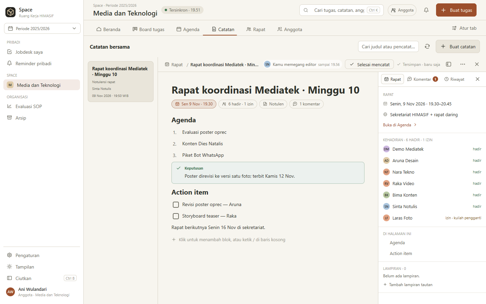
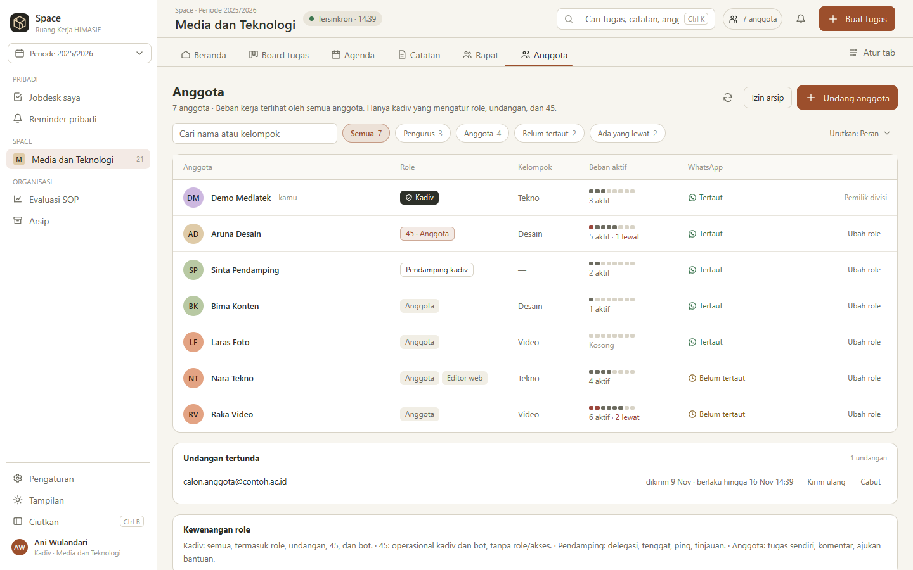
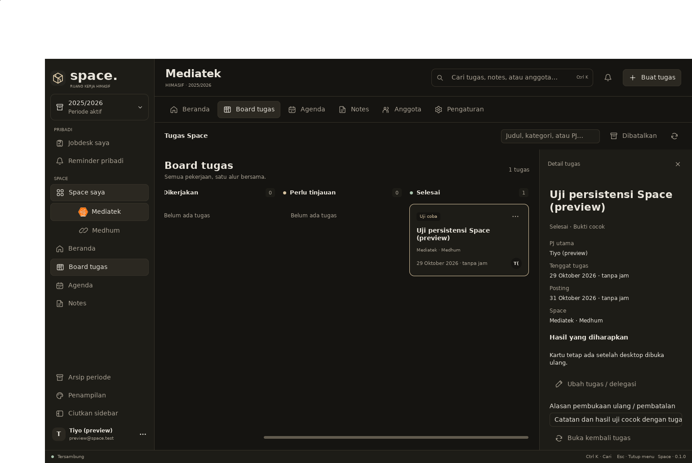

<div align="center">

# Space — Ruang Kerja HIMASIF

**Tugas, rapat, catatan, dan pengingat pengurus HIMASIF dalam satu tempat: di Windows, di web, dan di grup WhatsApp.**

[Unduh untuk Windows](https://space.tiyoouw.app/unduh/windows) · [Buka versi web](https://space.tiyoouw.app) · [Catatan rilis](CHANGELOG.md) · [Berkontribusi](CONTRIBUTING.md)

</div>

> **English summary.** Space is the workspace app of HIMASIF (the Information Systems student association at Universitas Jember) for its 2025/2026 board. Every division gets a *Space* with a task board, meetings, shared notes and members; each member sees their own tasks, meetings and reminders in one timeline (*Untukku*), and gets them on their Windows desktop (tray, notifications, the *Ace* island) and in their division's WhatsApp group. It is a Go monorepo: one HTTP API server with PostgreSQL, one native UI client (MyGo) built both as a Windows desktop app and as a WebAssembly web app, and a separate Node WhatsApp bridge. Status: pilot, pre-1.0, release candidates on the `rc` channel. Download: [`/unduh/windows`](https://space.tiyoouw.app/unduh/windows). Contributor docs are in Indonesian ([CONTRIBUTING.md](CONTRIBUTING.md)); AI agents and English readers start at [AGENTS.md](AGENTS.md).

<p align="center">
  
</p>

## Apa itu Space

Selepas rapat, tugas dan tenggat mudah terlupa, pembagian kerja tercecer di chat, dan spreadsheet jarang dibuka. Space mendokumentasikan setiap tugas dengan hasil yang diminta, satu PJ utama, dan tenggatnya, lalu mengingatkan langsung di perangkat dan WhatsApp. Ping dari kadiv hanya bantuan koordinasi; Space tidak dibuat untuk menagih.

- Setiap **divisi** punya Space sendiri per **periode** kepengurusan (2025/2026, 2026/2027, …).
- Pekerjaan lintas divisi, seperti **Medhum** (Mediatek × Humas), punya ruang bersama tanpa menyalin tugas.
- Maskot bawaannya bernama **Ace**, yang juga tampil sebagai *island* kecil di desktop.

Status: **pilot, sebelum 1.0.** Dipakai Mediatek dan Humas lebih dulu. Kebutuhan lengkap ada di [PRD](docs/PRD.md).

<p align="center">
  
  
</p>

## Unduh dan pasang

**Windows (64-bit)**

1. Unduh installer terbaru dari **<https://space.tiyoouw.app/unduh/windows>**. Tautan ini selalu mengarah ke rilis stabil terbaru, atau ke rilis uji coba (rc) selama belum ada yang stabil.
2. Jalankan `space-setup-<versi>-amd64.exe`. Space terpasang per pengguna, tanpa hak admin.
3. Installer belum bertanda tangan Authenticode, jadi Windows SmartScreen mungkin bertanya. Pilih **More info › Run anyway**.
4. Masuk dengan akun dari undangan email. Setelah itu Space memperbarui dirinya sendiri lewat kartu di kiri bawah jendela.

Semua installer dan checksum juga ada di [GitHub Releases](https://github.com/himasifunej/himasif-space/releases).

**Web:** buka <https://space.tiyoouw.app> di browser. Web selalu memuat versi yang sedang disajikan server, tanpa instalasi; tray, notifikasi Windows, dan Ace hanya ada di aplikasi desktop.

Android (Flutter) dan iOS direncanakan setelah tahap desktop/web.

## Fitur

**Kerja harian**
- **Untukku**: satu linimasa per hari (lewat tenggat, hari ini, besok, sisa minggu) berisi tugas, rapat, dan pengingatmu dari semua Space, dengan pita "Berikutnya".
- **Board tugas**: Belum mulai › Dikerjakan › Perlu tinjauan › Selesai. Setiap tugas punya PJ utama, pelaksana tambahan, tenggat, hasil yang diharapkan, lampiran, riwayat, dan alasan pembatalan.
- **Tinjauan hasil**: hasil diajukan berupa tautan atau berkas, lalu disetujui kadiv atau 45.
- **Reminder pribadi** yang privat secara bawaan, dan **ping** ke anggota tentang tugas atau rapat.

**Rapat dan catatan**
- **Rapat**: agenda, kehadiran, timer rapat, dan notulensi.
- **Catatan bersama** berbasis blok, dengan template, komentar, riwayat, penguncian editor, dan berbagi.
- **Agenda** dan kalender periode.

**Organisasi**
- **Anggota dan role**: Kadiv, 45 (pengganti operasional kadiv), Pendamping kadiv, Anggota, dan role kustom. Undangan lewat email.
- **Periode dan arsip**: serah terima ke periode berikutnya, arsip yang tetap bisa dibaca sesuai izin.
- **Evaluasi SOP Medhum**: bukti penyerahan dari WhatsApp dicocokkan ke tugas, menjadi temuan yang bisa ditinjau.

**Desktop Windows**
- Tray, mulai saat login, notifikasi Windows, suara kustom, dan **Ace Island** dengan kotak masuk kabar.
- Penyimpanan offline dan berkas tertunda yang dikirim saat koneksi kembali.
- **Pembaruan otomatis** dengan manifest bertanda tangan ed25519.
- Tautan `space://tugas/<id>` dan `space://rapat/<id>` membuka kartu langsung di aplikasi.
- **Ctrl K** untuk mencari tugas, catatan, anggota, dan pengaturan.

**WhatsApp**
- Bot tanpa AI per divisi: `!tugas`, `!hari`, `!cek`, dan perintah lain, plus pengingat terjadwal.
- Setiap pesan tentang tugas atau rapat membawa tautan "Buka di Space".

**Operasional**
- Backup dan restore terenkripsi, karantina, CSV darurat dengan rekonsiliasi, dan halaman Status layanan.

## Arsitektur

```
           ┌─────────────────────────────┐         ┌──────────────────────┐
 Windows   │ app/  (MyGo native UI)      │         │ bridge/  (Node 22)   │
 desktop ──┤  internal/appui · client    │  HTTPS  │  Baileys, sesi WA,   │◀── WhatsApp
           │  internal/island · update   ├────┐    │  media, receipt      │
 Browser ──┤  (sama, dikompilasi ke WASM)│    │    └──────────▲───────────┘
           └─────────────────────────────┘    │               │ bearer internal
                                              ▼               │
                              ┌───────────────────────────────┴──┐
                              │ cmd/space-server  (Go, net/http) │
                              │  internal/server · authz · sop   │
                              │  whatsapp · mail · integrations  │
                              │  menyajikan web app (app/build)  │
                              └───────────────┬──────────────────┘
                                              │ pgx, SQL tulis tangan
                                              ▼
                                     PostgreSQL 17 (internal/store)
```

- **Satu klien, dua target.** `app/` dan `internal/appui` digambar dengan MyGo native UI. Build Windows menjadi aplikasi desktop native tanpa WebView; build `js/wasm` menjadi aplikasi web yang disajikan server. Berkas khusus platform dipisah dengan build tag (`*_desktop.go`, `*_web.go`, `*_windows.go`).
- **Server satu-satunya penentu wewenang.** Klien hanya menyembunyikan menu; setiap izin diperiksa di `internal/authz` dan `internal/server`.
- **Pesan JSON** antara server dan klien ada di `internal/api`, dipakai bersama oleh keduanya.
- **Data** di PostgreSQL dengan migrasi SQL bernomor yang ter-embed (`internal/store/migrations`), ID UUIDv7, dan audit append-only.
- **Bridge WhatsApp** adalah layanan terpisah yang hanya menangani transport, sesi, dan media; semua keputusan bisnis ada di server Go.
- **Pembaruan desktop** dibaca dari feed bertanda tangan di GitHub Releases (`update-feed`), bukan dari server.

Keputusan teknis ada di [ADR 0001](docs/adr/0001-fondasi-teknis.md), peta kode lengkap di [AGENTS.md](AGENTS.md).

## Menjalankan untuk pengembangan

Prasyarat: **Go 1.27+**, **PostgreSQL** (16/17), Python 3, dan (opsional) [Mailpit](https://mailpit.axllent.org) untuk menangkap email. Bridge WhatsApp butuh Node 22+ dan FFmpeg.

```bash
git clone https://github.com/himasifunej/himasif-space.git
cd himasif-space

mkdir -p ~/.config/himasif-space
cp .env.example ~/.config/himasif-space/dev.env   # isi nilainya
chmod 600 ~/.config/himasif-space/dev.env

make seed        # migrasi + periode 2025/2026, divisi, akun admin organisasi
make web         # build aplikasi web ke app/build/web
make serve       # API + web di http://localhost:8787
```

Aplikasi desktop: `go tool mygo dev ./app` (butuh layar), atau build Windows dengan `make desktop-windows`. Desktop memakai `SPACE_API_URL` (bawaan rilis: server produksi).

Pengujian:

```bash
make check       # gofmt, go vet (linux/windows/wasm), unit test
make test-db     # termasuk test server terhadap PostgreSQL (SPACE_TEST_DATABASE_URL)
cd bridge && npm test
```

Secret (database, SMTP, bot, kunci penanda tangan) **tidak boleh** masuk repository; simpan di file env di luar repo.

## Kanal rilis

| Kanal | Isi | Siapa |
|---|---|---|
| **Stabil** (`stable.json`) | Versi tanpa akhiran, mis. `0.4.6` | Bawaan semua pengguna desktop |
| **Uji coba / rc** (`rc.json`) | Pre-release, mis. `0.4.6-rc.3` | Penguji pilot; mendapat juga rilis stabil yang lebih baru |
| **Web** | Versi yang sedang disajikan server | Semua pengguna browser |

- Kanal dipilih di Pengaturan › Perangkat › Pembaruan aplikasi › **Kanal pembaruan**. Desktop memeriksa 20 detik setelah dibuka, lalu setiap 6 jam.
- Manifest ditandatangani ed25519 dan diterbitkan di rilis tetap [`update-feed`](https://github.com/himasifunej/himasif-space/releases/tag/update-feed); installer ada di rilis `v<versi>`.
- Versi sebelum 1.0: **patch** naik di setiap pembaruan, **minor** untuk pembaruan besar, **1.0.0** untuk rilis publik.

Rincian: [docs/operations/auto-update.md](docs/operations/auto-update.md) dan [docs/operations/distribution.md](docs/operations/distribution.md).

## Dokumentasi

| Dokumen | Isi |
|---|---|
| [docs/PRD.md](docs/PRD.md) | Kebutuhan produk dan ID kebutuhan |
| [docs/decision-register.md](docs/decision-register.md) | Keputusan Q1–Q74 |
| [docs/adr/](docs/adr) | Keputusan teknis |
| [docs/implementation-plan.md](docs/implementation-plan.md) | Urutan pengerjaan |
| [docs/operations/](docs/operations) | Rilis, pembaruan, backup/restore, CSV darurat, email, pilot |
| [docs/handoff/](docs/handoff) | Catatan serah terima per tahap |
| [CHANGELOG.md](CHANGELOG.md) | Catatan rilis |

## Kredit

Space adalah proyek **HIMASIF ASTRA 2025/2026**, Himpunan Mahasiswa Sistem Informasi, Universitas Jember.

<table>
  <tr>
    <td align="center" width="140">
      <a href="https://github.com/Tiyouw"></a>
    </td>
    <td>
      <b>Ahimsa Jenar Bramsaifstyo Kusuma</b> (Tiyoouw)<br>
      Pengembang utama · Mediatek HIMASIF 25/26<br>
      Merancang dan membangun Space: produk, server, aplikasi desktop/web, bot WhatsApp, dan rilis.<br>
      <a href="https://tiyoouw.com">tiyoouw.com</a> · <a href="https://github.com/Tiyouw">@Tiyouw</a>
    </td>
  </tr>
</table>

Terima kasih kepada pengurus Mediatek dan Humas yang menjadi pengguna pilot dan memberi masukan di setiap rilis uji coba.

## Kontributor

Semua yang ikut membangun Space tercatat di [`contributors.json`](contributors.json), yang juga dibaca halaman **Kredit** di aplikasi. Sudah berkontribusi? Tambahkan dirimu lewat PR; formatnya dijelaskan di [docs/contributors.md](docs/contributors.md).

<a href="https://github.com/himasifunej/himasif-space/graphs/contributors">
  
</a>

Ingin ikut? Baca [CONTRIBUTING.md](CONTRIBUTING.md) dan [Kode Etik](CODE_OF_CONDUCT.md).

## Lisensi

[MIT](LICENSE) © 2026 Himasif Unej.
