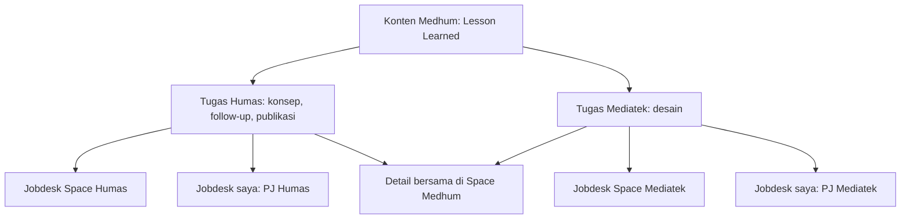
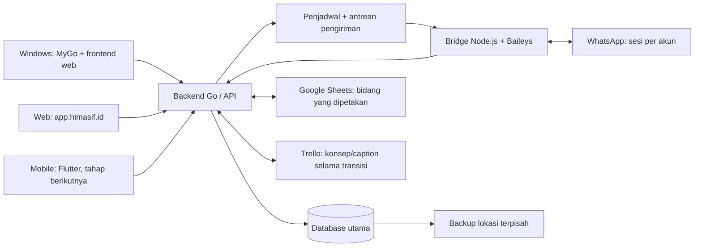

# PRD Space — Ruang Kerja HIMASIF

Versi: 1.0  
Tanggal: 27 Oktober 2026, WIB  
Status: PRD sebelum implementasi; keputusan produk berasal dari pembahasan Q1–Q74 dan konfirmasi pengguna.  
Pemilik kebutuhan awal: Ahimsa, Kadiv Mediatek HIMASIF.  
Nama repository yang disepakati: `himasif-space`. Folder kerja saat penyusunan masih bernama `HIMASIF`; dokumen ini tidak mengubahnya atau membuat repository jarak jauh.

## 1. Tujuan dan cara membaca dokumen

Space adalah aplikasi kerja pengurus HIMASIF: setiap divisi memiliki ruang kerja, anggota memiliki jobdesk pribadi, dan pekerjaan lintas divisi terhubung melalui ruang bersama. Maskot bawaan bernama **Ace**.

Masalah utama adalah anggota lupa tugas dan deadline sesudah rapat, dokumentasi pembagian tugas kurang jelas, dan spreadsheet tidak selalu dibuka. Space mendokumentasikan tugas dan mengirim pengingat langsung ke perangkat serta WhatsApp. Ping kadiv merupakan bantuan koordinasi; produk tidak berpusat pada penagihan manual.

Tujuan rilis awal:

1. Setiap tugas organisasi jelas hasil yang diminta, PJ utama, dan tenggatnya.
2. Tugas yang sama konsisten di jobdesk pribadi, Space divisi, dan ruang kolaborasi terkait.
3. Anggota menerima reminder dan ping tanpa harus membuka spreadsheet.
4. Mediatek dan Humas dapat menjalankan Medhum dengan bukti waktu penyerahan dan evaluasi SOP yang bisa ditinjau.
5. Data tetap dapat diakses melalui web, cache perangkat, arsip, dan mekanisme pemulihan sesuai jenis gangguannya.
6. Akun, role, arsip, serta serah terima mendukung periode berikutnya.

Penanda dalam dokumen:

- **Disepakati:** keputusan eksplisit pengguna atau rangkuman yang telah dikonfirmasi.
- **Turunan:** perilaku pendukung agar keputusan tersebut konsisten dan dapat diuji; bukan fitur baru yang sudah pernah didemokan.
- **Belum ditentukan:** parameter, desain visual, atau pilihan teknis yang belum disepakati. Dicatat pada bagian 26, bukan diasumsikan sudah diputuskan.
- **Lanjutan:** kebutuhan yang dipertahankan dalam roadmap tetapi tidak wajib untuk pilot Medhum.

ID kebutuhan dipakai sebagai acuan implementasi dan pengujian. [Register keputusan](decision-register.md) menelusuri Q1–Q74, termasuk koreksi yang menggantikan jawaban sebelumnya. [Rencana implementasi](implementation-plan.md) menguraikan urutan pengerjaan. Tidak ada kode aplikasi yang diimplementasikan sebagai bagian penyusunan PRD ini.

## 2. Cakupan dan keberhasilan

### 2.1 Cakupan rilis awal

- Pilot pengguna: Mediatek dan Humas; Litbang untuk evaluasi SOP dan BPH untuk pemantauan sesuai aksesnya.
- Windows desktop dengan MyGo dan frontend web; web sederhana tersedia sejak pengembangan fondasi/pekerjaan.
- Akun, undangan email, periode, keanggotaan, Space, role dan akses arsip.
- Tugas, delegasi, pengajuan bantuan, jobdesk, reminder pribadi dan pengaturan privasi.
- Notes, template, tabel jadwal, notulensi, rapat, kehadiran, dan ping.
- Tray, mulai saat login, notifikasi Windows, suara kustom, Ace, dan penyimpanan offline.
- Bot WhatsApp tanpa AI, satu sesi per akun terhubung, konfigurasi per divisi, command operasional dan command hiburan.
- Alur Medhum, sinkronisasi spreadsheet/Trello selama transisi, bukti WhatsApp, temuan SOP, rekap mingguan dan evaluasi kuartalan.
- Backup, spreadsheet darurat, status integrasi, pemulihan dan distribusi aplikasi.

Android menggunakan Flutter dalam tahap tersendiri sesudah fondasi desktop/web dan operasional. iOS merupakan kemungkinan berikutnya, bukan syarat pilot. Pengurus sasaran diwajibkan memasang aplikasi sesuai tahap peluncuran; kewajiban belum berlaku untuk seluruh divisi sebelum fiturnya siap.

### 2.2 Ukuran keberhasilan

| Ukuran | Definisi pengamatan | Ketentuan |
|---|---|---|
| Keterlambatan penyerahan | Perbandingan tenggat dengan waktu penyerahan yang sudah dicocokkan ke tugas | Ukuran utama; tidak memakai waktu klik selesai sebagai bukti tunggal |
| Kejelasan dokumentasi | Tugas resmi memiliki hasil yang diminta, PJ utama, dan tenggat yang jelas | Wajib untuk tugas yang dibagikan |
| Keandalan reminder | Reminder yang jatuh tempo memiliki status antre/kirim/gagal yang dapat diperiksa | Tidak menyamakan scheduler sukses dengan pesan terkirim |
| Koordinasi | Jobdesk dan perubahan delegasi konsisten di semua tampilan terkait | Tidak ada salinan tugas yang divergen |
| Ketepatan evaluasi SOP | Temuan memiliki bukti, status tinjauan dan alasan koreksi | Tidak menghukum berdasarkan dugaan tanpa tinjauan |
| Efisiensi perangkat | Penggunaan RAM, CPU, baterai, ukuran rilis, dan waktu buka pada perangkat sasaran | Dicatat saat implementasi; tidak mengklaim framework pasti paling ringan |

Baseline keterlambatan, rentang evaluasi keberhasilan, dan target numerik belum tersedia. Ambil baseline pilot sebelum menyatakan ada penurunan keterlambatan. Berkurangnya kebutuhan mengingatkan secara manual adalah manfaat tambahan.

## 3. Istilah produk

| Istilah | Makna |
|---|---|
| Space | Brand aplikasi; juga sebutan ruang kerja sesuai konteks |
| Space divisi | Ruang seluruh anggota satu divisi pada satu periode |
| Space Medhum | Ruang kerja bersama Humas–Mediatek untuk konten, bukan penggabungan semua pekerjaan kedua divisi |
| Jobdesk saya | Tampilan tugas organisasi yang ditujukan kepada pengguna dari ruang-ruang yang dapat diaksesnya |
| Jobdesk divisi | Seluruh tugas organisasi yang menjadi pekerjaan divisi tersebut |
| Reminder pribadi | Pengingat milik pengguna, privat secara default, bukan otomatis tugas resmi divisi |
| PJ utama | Satu orang yang memegang tanggung jawab utama atas sebuah tugas |
| Pelaksana tambahan | Anggota yang ditambahkan untuk membantu setelah persetujuan pengelola tugas |
| Pendamping Kadiv | Role operasional yang mendampingi kadiv; nama dapat dikustomisasi |
| 45 | Role pengganti operasional kadiv sampai dicopot kadiv asli; bukan nama Plt. dalam UI |
| Periode | Kepengurusan seperti 2025/2026 atau 2026/2027 |
| Bukti penyerahan | Pesan, tautan, identitas pengirim, dan waktu yang dicocokkan ke tahap tugas |
| Perlu tinjauan | Pencocokan bukti ke tugas belum dipastikan; bukan permintaan revisi desain |
| Temuan SOP | Dugaan pelanggaran berdasarkan kejadian dan aturan; belum tentu pelanggaran yang disahkan |
| Reo | Sistem agent/bot lama dan sumber pelajaran operasional; AI Reo bukan ketergantungan rilis Space |

## 4. Akun, keanggotaan dan hak akses

### 4.1 Persona dan ruang lingkup

| Persona | Kebutuhan utama | Batas ruang lingkup |
|---|---|---|
| Anggota | Melihat pekerjaan divisi, menjalankan tugas sendiri, menawarkan bantuan, membaca notes, menerima reminder | Divisi/periode dan ruang bersama yang diizinkan |
| Kadiv asli | Mengelola divisi, PJ, deadline, tinjauan, role, undangan, arsip, bot dan role 45 | Divisi/periode yang dipimpinnya |
| Pendamping Kadiv | Delegasi, deadline, ping, dan tinjauan kecocokan hasil | Tidak mengelola role/akses atau koneksi WA secara default |
| Pemegang 45 | Kewenangan operasional kadiv termasuk pengelolaan WA | Dilarang mengubah role atau akses; tidak dapat mencopot/mengangkat 45 |
| Humas | Kalender, konsep/caption, follow-up dan publikasi | Space Humas dan pekerjaan Medhum |
| Mediatek | Desain, tekno, video, delegasi internal | Space Mediatek dan pekerjaan Medhum |
| Litbang | Membaca bukti, meninjau temuan dan melakukan evaluasi SOP | Akses evaluasi yang diberikan; tidak otomatis notes internal semua divisi |
| BPH | Pemantauan organisasi lintas divisi | Bukan akses otomatis ke reminder pribadi atau seluruh notes privat |
| Admin organisasi | Periode, penetapan kadiv, pengelolaan keanggotaan dan kontinuitas sistem | Satu akun organisasi; tidak berarti semua data pribadi dipublikasikan |

### 4.2 Matriks kemampuan bawaan

`Ya` selalu dibatasi divisi/periode/ruang terkait. Role tambahan dapat mempersempit atau memberi kemampuan operasional sesuai pengaturan kadiv, tetapi tidak boleh menghilangkan larangan role 45 terhadap role dan akses.

| Kemampuan | Anggota | Pendamping | 45 | Kadiv asli | Admin organisasi |
|---|---|---|---|---|---|
| Melihat seluruh jobdesk divisinya | Ya | Ya | Ya | Ya | Sesuai ruang administrasi |
| Memperbarui progres tugas sendiri | Ya | Ya | Ya | Ya | Sesuai kewenangan |
| Berkomentar dan mengajukan bantuan | Ya | Ya | Ya | Ya | Sesuai keanggotaan |
| Mengatur delegasi, PJ dan deadline | Tidak | Ya | Ya | Ya | Sesuai kewenangan |
| Meninjau kecocokan hasil | Tidak | Ya | Ya | Ya | Sesuai kewenangan |
| Mengirim ping organisasi | Tidak secara default | Ya | Ya | Ya | Sesuai kewenangan |
| Mengelola konfigurasi/koneksi WA | Tidak | Tidak secara default | Ya | Ya | Pemulihan/administrasi |
| Mengundang anggota / memberi akses arsip | Tidak | Tidak | Tidak | Ya | Ya |
| Mengatur role atau hak akses | Tidak | Tidak | Tidak | Ya | Ya |
| Menunjuk/mencopot 45 | Tidak | Tidak | Tidak | Ya | Tidak; khusus kadiv asli |
| Membuat periode / menetapkan kadiv asli | Tidak | Tidak | Tidak | Tidak secara default | Ya |
| Membuka reminder pribadi orang lain | Hanya jika dibagikan | Hanya jika dibagikan | Hanya jika dibagikan | Hanya jika dibagikan | Tidak otomatis |

Peninjauan **temuan SOP** mengikuti kewenangan kadiv/Litbang, terpisah dari kemampuan meninjau **kecocokan hasil**. Detail pembagian pengesahan lintas divisi dicatat pada bagian 26.

### 4.3 Kebutuhan akun dan role

- **ACC-01 — Disepakati:** satu orang memiliki satu akun yang dapat dipakai lintas periode. Perubahan jabatan tidak membuat akun baru.
- **ACC-02 — Disepakati:** kadiv menyiapkan undangan berdasarkan email pengurus. Tautan dapat dibagikan lewat WhatsApp tanpa mengirim password.
- **ACC-03 — Disepakati:** penerima baru membuat akun dan memverifikasi email yang diundang; penerima lama masuk ke akun yang sama. Keanggotaan divisi/periode berasal dari undangan dan tidak memerlukan tinjauan ulang sesudah undangan valid diterima.
- **ACC-04 — Turunan:** undangan berikat pada identitas/divisi/periode, hanya dapat diterima sekali, dan bisa dicabut. Cara autentikasi dan masa berlaku token ditentukan pada rancangan teknis.
- **ACC-05 — Disepakati:** seluruh anggota, bukan hanya kadiv, bisa masuk Space divisinya. Seluruh Humas dan Mediatek dapat mengakses Medhum pada periode terkait.
- **ACC-06 — Disepakati:** subdivisi Tekno, Desain dan Video adalah pengelompokan pekerjaan/anggota, tidak otomatis memberi kewenangan kadiv. Satu pengguna dapat memiliki beberapa pengelompokan dan role.
- **ACC-07 — Disepakati:** role bisa dikustomisasi per divisi. Template awal adalah Anggota, Pendamping Kadiv, Kadiv, dan 45. Senioritas/angkatan tidak otomatis memberi akses.
- **ACC-08 — Disepakati:** maksimal satu pemegang 45 aktif per divisi; berlaku tanpa tanggal kedaluwarsa sampai kadiv asli mencopotnya. Kadiv asli tetap berwenang penuh.
- **ACC-09 — Disepakati:** 45 dapat mengelola WA dan operasi divisi; pilihan kewenangan tersedia dengan default tersebut. Pengelolaan role/akses selalu dikecualikan, termasuk undangan dan pemberian akses arsip.
- **ACC-10 — Turunan:** batas kewenangan ditegakkan di server, termasuk tindakan lewat command WA, impor, dan operasi offline yang disinkronkan. Menyembunyikan tombol bukan satu-satunya pembatasan.
- **ACC-11 — Turunan:** pemberi role tidak dapat memberi hak melebihi kewenangannya. Setiap perubahan mencatat pelaku, waktu, ruang lingkup dan nilai sebelum/sesudah.
- **ACC-12 — Disepakati:** satu akun admin organisasi diteruskan antarperiode, terpisah dari akun pribadi. Saat serah terima, penerus mengganti kredensial/pemulihan dan mengakhiri sesi lama.
- **ACC-13 — Turunan:** audit tindakan admin mencatat akun admin bersama; sistem tidak mengarang identitas pribadi pelaku di balik kredensial bersama. Catatan serah terima mencatat siapa pengelolanya.

## 5. Periode, arsip dan serah terima

- **PER-01 — Disepakati:** UI memiliki pemilih periode; ruang kerja, keanggotaan, jabatan, akses, kalender dan laporan terikat periode.
- **PER-02 — Disepakati:** periode baru dapat memakai struktur divisi sebelumnya, tetapi tidak otomatis menyalin daftar pengurus, role individual, atau tugas.
- **PER-03 — Disepakati:** pengurus lama tetap dapat membaca arsip ruang yang dulu boleh diaksesnya sesuai riwayat izin. Tidak ada akses otomatis ke pekerjaan periode baru.
- **PER-04 — Disepakati:** pengurus baru hanya melihat arsip sebelumnya setelah diizinkan kadiv periode aktif. Akses dapat dibatasi pada arsip divisi atau ruang tertentu; Medhum mengikuti akses ruang bersama.
- **PER-05 — Disepakati:** periode yang ditutup menjadi hanya-baca. Notes privat dan reminder pribadi tidak ikut terbuka karena pemberian akses arsip.
- **PER-06 — Disepakati:** jika ada pekerjaan tersisa, pengelola menutupnya atau meneruskannya secara eksplisit dengan PJ baru dan hubungan ke tugas/periode asal. Tidak mengganti tanggung jawab lama secara diam-diam.
- **PER-07 — Disepakati:** serah terima mencakup pengurus/kadiv baru, admin organisasi, pengelolaan bot, pilihan arsip, penutupan periode dan pengecekan tugas tersisa. Tidak mensyaratkan adanya tugas tertunda.
- **PER-08 — Turunan:** jadwal reminder/bot periode lama tidak terus aktif setelah ruang terkait ditutup; tugas yang diteruskan mendapatkan jadwal pada periode tujuan tanpa menggandakan pengiriman.
- **PER-09 — Turunan:** waktu aktivasi periode baru, penutupan yang lama, dan izin arsip dapat dikelola sebagai langkah terpisah sehingga serah terima tidak menghapus pekerjaan saat persiapan berlangsung.

## 6. Model Space dan jobdesk

- **SPC-01 — Disepakati:** tampilan pribadi, divisi dan Medhum mereferensikan tugas yang sama, bukan salinan yang perlu diperbarui satu per satu.
- **SPC-02 — Disepakati:** tugas internal seperti maintenance web tetap di Mediatek dan tidak otomatis terlihat oleh Humas.
- **SPC-03 — Disepakati:** ruang bersama berisi tugas/notes yang sengaja menjadi pekerjaan bersama. Medhum menampilkan konsep, caption/tautan, tanggal, PJ Humas, PJ desain, delegasi, status, bukti dan waktu kejadian.
- **SPC-04 — Disepakati:** semua anggota divisi bisa melihat beban kerja rekan. Perubahan progres oleh anggota dibatasi pada tugasnya sendiri; komentar dan pengajuan bantuan dapat dilakukan pada pekerjaan rekan sesuai akses ruang.
- **SPC-05 — Turunan:** filter minimum meliputi periode, ruang/divisi, PJ, tenggat dan status. Jobdesk saya dapat menggabungkan beberapa ruang tanpa mengubah ruang asal tugas.
- **SPC-06 — Turunan:** membuka tugas dari toast, Ace, WA atau web menuju detail tugas yang sama setelah memeriksa akses saat itu.

## 7. Tugas, delegasi dan penyerahan

### 7.1 Data minimum

Tugas resmi memiliki identitas stabil, periode, ruang/divisi asal, judul, hasil yang diminta, satu PJ utama, tanggal/jam tenggat atau penanda tanggal tanpa jam, pembuat/delegator, status, aturan reminder dan riwayat perubahan. Data tambahan: pelaksana tambahan, lampiran/tautan, komentar, sumber rapat/note, konten Medhum terkait, serta bukti penyerahan.

- **TSK-01 — Disepakati:** tugas dapat dicatat saat atau sesudah rapat, tetapi harus terdokumentasi sebelum dianggap resmi dibagikan. Hasil yang diminta, PJ utama dan tenggat harus jelas.
- **TSK-02 — Disepakati:** delegasi baru langsung muncul di jobdesk PJ, divisi asal dan ruang bersama terkait, serta memicu notifikasi penugasan.
- **TSK-03 — Disepakati:** anggota dapat mengajukan diri membantu. Kadiv/pengelola berwenang menerima atau menolak; diterima berarti menjadi pelaksana tambahan, bukan mengganti PJ utama otomatis.
- **TSK-04 — Disepakati:** pengelola dapat mengubah PJ/deadline. Perubahan relevan diberitahukan kepada pihak yang terdampak.
- **TSK-05 — Turunan:** pergantian PJ, tenggat dan pembatalan menyimpan riwayat/alasan yang diperlukan untuk menafsirkan keterlambatan. Penjadwal membatalkan reminder lama yang tidak lagi relevan.
- **TSK-06 — Disepakati:** status penyerahan dan kecocokan bukti terpisah dari apakah desain perlu revisi. Rilis awal tidak memiliki alur status revisi desain.
- **TSK-07 — Disepakati:** hasil yang belum jelas tugasnya ditampilkan sebagai **“Hasil dikirim — perlu tinjauan”**, bukan final approval mutu desain.
- **TSK-08 — Disepakati:** setelah kecocokan penyerahan dipastikan, tahap tugas tersebut selesai. Selesai tugas desain tidak otomatis berarti konten sudah dipublikasikan.
- **TSK-09 — Turunan:** tugas yang sudah selesai tetap bisa menerima koreksi bukti/temuan SOP oleh pihak berwenang. Mengubah status tidak menghapus riwayat.

### 7.2 Status dan fakta yang tidak boleh dicampur

| Dimensi | Nilai konseptual | Catatan |
|---|---|---|
| Progres tugas | Belum mulai, dikerjakan, hasil dikirim, selesai, dibatalkan | Label UI final dapat dirapikan tanpa mengubah makna |
| Pencocokan bukti | Belum ada, perlu tinjauan, cocok, tidak cocok | “Perlu tinjauan” bukan revisi desain |
| Tenggat | Belum lewat, terlewati | Dihitung terhadap tenggat yang berlaku dan pengecualian yang tercatat |
| Temuan SOP | Perlu tinjauan, disahkan, dibatalkan/dikoreksi | Bukan konsekuensi otomatis dari klik selesai terlambat |
| Pengakuan ping | Belum dilihat, sudah lihat, ditunda | Tidak menyelesaikan tugas atau membuktikan hadir rapat |

Jika bukti WA cocok ke tepat satu tugas aktif milik pengirim, penyerahan dapat dicatat sementara dan reminder penyerahan tugas itu ditahan selama tinjauan. Jika ambigu, tidak ada tugas yang diam-diam dinyatakan selesai. Jika tinjauan menolak kecocokan, riwayat dipertahankan dan reminder yang relevan dapat aktif kembali.

## 8. Reminder pribadi dan privasi

- **PRI-01 — Disepakati:** pengguna dapat membuat reminder sendiri tanpa menjadikannya pekerjaan divisi.
- **PRI-02 — Disepakati:** privat secara default; toggle berbagi dapat diubah kapan saja pada setiap reminder. Pengguna dapat mengatur default untuk reminder baru.
- **PRI-03 — Disepakati:** berbagi ke kadiv berarti berbagi kepada akun orang yang dipilih saat itu, bukan seluruh pemegang jabatan kadiv sepanjang masa.
- **PRI-04 — Disepakati:** kadiv pengganti, role 45, admin, BPH dan penerus periode tidak otomatis menerima akses yang diberikan kepada kadiv sebelumnya.
- **PRI-05 — Disepakati:** pemilik melihat penerima akses, dapat mencabutnya, dan perubahan default tidak otomatis membuka reminder lama.
- **PRI-06 — Disepakati:** reminder pribadi hanya dikirim ke perangkat pemilik, bukan grup WA, meskipun isinya dibagikan untuk dilihat kadiv.
- **PRI-07 — Turunan:** pemberian akses hanya-baca tidak memberikan kewenangan mengubah reminder, mengubah pemilik, atau mengubahnya menjadi tugas divisi. Perubahan semacam itu memerlukan tindakan tersendiri yang jelas.
- **PRI-08 — Turunan:** ekspor, cache, pencarian, arsip dan laporan tetap mengikuti privasi objek sumber; akses ruang tidak boleh membocorkan reminder pribadi.

## 9. Alur Medhum

### 9.1 Tahap dan kepemilikan

1. Humas mengelola kalender posting serta konsep/caption.
2. Kadiv Mediatek menentukan PJ desain; daftar lama dari spreadsheet menjadi data transisi yang dipetakan, bukan pemindahan wewenang ke Humas.
3. Konfirmasi konsep oleh PJ Humas melalui template broadcast dicatat per konten dan PJ.
4. Tahap penyerahan konsep Humas selesai ketika bukti yang cocok tercatat; tugas follow-up/publikasi Humas masih dapat berjalan.
5. PJ Mediatek menerima tugas/notifikasi, termasuk jadwal posting dan deadline desain.
6. Bot Humas mendukung follow-up H-4 di Medhum.
7. PJ desain mengirim tautan Drive ke Medhum; bot mencatat/mencocokkan bukti dan memberi balasan yang menyebut tinjauan bila diperlukan.
8. Kadiv/pengelola meninjau kecocokan bukti; tidak perlu status revisi desain dalam produk awal.
9. Publikasi tetap pekerjaan Humas dan tidak otomatis dianggap terjadi karena desain telah diserahkan.
10. Sistem menghasilkan temuan SOP berbukti untuk tinjauan dan evaluasi; tidak mengumumkan keputusan pelanggaran ke Medhum.

### 9.2 Aturan tanggal

- **MED-01 — Disepakati:** tanggal yang diumumkan Humas adalah **tanggal/jadwal posting**, termasuk template lama yang menulis “tanggal = DL”.
- **MED-02 — Disepakati:** deadline desain khusus Mediatek dihitung **jadwal posting dikurangi dua hari, tepat satu kali**. Posting tanggal 20 berarti deadline desain tanggal 18; tidak dikurangi lagi menjadi 16.
- **MED-03 — Disepakati:** UI, pesan dan impor membedakan label **Jadwal posting** dan **Deadline desain**. Simpan kedua nilai beserta sumber dan perubahan historisnya.
- **MED-04 — Turunan:** perhitungan lintas bulan/tahun memakai zona waktu ruang yang disepakati, default WIB. Tanggal kalender dan waktu persis harus dibedakan; tanggal tanpa jam tidak boleh dianggap memiliki jam yang belum ditentukan.
- **MED-05 — Turunan:** sumber yang hanya memiliki tanggal dapat diimpor sebagai tanggal. Jam posting/batas penyerahan harus dikonfigurasi eksplisit sebelum aturan berbasis jam seperti H-12 atau 24 jam dinilai otomatis.
- **MED-06 — Disepakati:** kesepakatan khusus, konsep terlambat, follow-up H-4 dan bukti penyerahan memengaruhi tinjauan SOP. Jangan menyederhanakan semua kasus menjadi H-2 mutlak.

### 9.3 Pemetaan SOP yang harus diperhitungkan

Acuan: [SOP Medhum revisi 28 Maret 2026](https://drive.google.com/file/d/1oh18JqCzPHyAkT3-YQevTJNB5Wzs4m7w/view). Tabel berikut adalah peta singkat aturan, bukan pengganti dokumen resmi. Aturan visual/isi memerlukan pemeriksaan manusia.

| Poin SOP | Implikasi kebutuhan |
|---|---|
| 7.1–7.3 | Humas mengelola perencanaan, PJ konten, kalender/caption dan Trello |
| 7.4 | Kadiv Mediatek menetapkan PJ desain |
| 7.5 | Permintaan matang H-7 atau kesepakatan khusus |
| 7.6–7.7 | Dadakan maksimal lima; pengecualian seminar proposal, seminar hasil magang, berita duka; hak menolak |
| 7.8–7.10 | Logo/footer, gaya desain dan isi konsep diperiksa manusia |
| 7.11 | Penyerahan H-2 memiliki kaitan pengecualian dengan 7.14 |
| 7.12–7.13 | Dadakan: konsep/konfirmasi 24 jam sebelumnya; koordinasi kadiv |
| 7.14 | Follow-up H-4 mencantumkan judul dan PJ desain |
| 7.15 | Bukti folder Drive dan pengiriman ke Medhum |
| 7.16–7.18 | Revisi satu hari, maksimal tiga; proses manusia, tanpa status revisi aplikasi |
| 7.19–7.20 | Final H-12 dan persetujuan sebelum dipakai Humas |
| 7.21–7.23 | Distribusi Humas, pemeriksaan caption/isi, publikasi dan feedback |
| 7.24–7.25 | Rapat kuartalan dan koordinasi ketentuan lain |

Kategori pengecualian dadakan, periode penghitungan batas lima postingan, serta interpretasi H-4 pada kasus khusus harus merujuk dokumen dan kesepakatan operasional. Sistem tidak menebak hukuman dari parameter yang belum ditetapkan.

- **MED-07 — Disepakati:** bot Humas dapat melakukan follow-up H-4 atas nama PJ konten dengan judul, tag PJ desain dan tautan konsep, serta menyimpan waktu pengiriman.
- **MED-08 — Disepakati:** penggunaan bot sebagai pemenuhan kewajiban follow-up mengikuti kesepakatan Humas/Litbang; sebelum itu perlakukan sebagai bantuan pengingat PJ. Berhasil mengirim satu pesan tidak membuktikan semua ketentuan SOP telah terpenuhi.
- **MED-09 — Disepakati:** revisi, final check dan approval mutu desain dapat tercermin dalam notes/bukti manusia; tidak menjadi workflow status revisi wajib pada rilis awal.

## 10. Bot WhatsApp tanpa AI

### 10.1 Akun, grup dan konfigurasi

- **BOT-01 — Disepakati:** bot bekerja tanpa model AI, API AI berbayar/gratis, atau ketergantungan pada agent Hermes. AI disimpan sebagai future plan.
- **BOT-02 — Disepakati:** divisi bebas memakai nomor khusus atau akun kadiv yang dihubungkan melalui QR. Satu akun WA memiliki sesi tersendiri di server.
- **BOT-03 — Disepakati:** koneksi dan penjadwal berjalan di server yang tetap aktif, bukan laptop kadiv. Bot Mediatek dan Humas dapat menjadi koneksi terpisah dalam satu lingkungan server.
- **BOT-04 — Disepakati:** bot Humas melayani grup Humas dan grup Medhum; bot Mediatek melayani grup Mediatek. Tidak memasukkan dua bot divisi ke Medhum untuk reminder yang sama.
- **BOT-05 — Disepakati:** nama bot dalam pesan, bahasa, sapaan dan template/gaya pesan dapat dikustomisasi ringan per divisi. Nama profil WA mengikuti akun terhubung; aplikasi tidak mengklaim mengganti identitas profil hanya dengan label pesan.
- **BOT-06 — Disepakati:** kadiv dan role 45 dapat mengelola/kustomisasi bot. Pendamping tidak mendapat kemampuan ini secara default.
- **BOT-07 — Turunan:** sesi akun, kredensial dan pemetaan grup terpisah; kegagalan koneksi satu bot tidak menghentikan operasi tugas atau bot lain.
- **BOT-08 — Turunan:** UI menampilkan akun terhubung, status koneksi, waktu kejadian terakhir, kebutuhan scan ulang, serta antrean gagal. Jangan menyatakan “berhasil dikirim” hanya karena job scheduler selesai.
- **BOT-09 — Turunan:** pengiriman menggunakan antrean dan identitas kejadian yang stabil agar retry/restart tidak mengirim pesan berulang tanpa batas. Status tidak diketahui dibedakan dari gagal sebelum terkirim.
- **BOT-10 — Turunan:** proses hanya pesan dari grup/pengirim yang relevan dan terhubung ke anggota. Identitas akun chat, bukan teks nama dalam pesan, menjadi dasar wewenang command.
- **BOT-11 — Turunan:** pengelolaan koneksi WA oleh 45 tidak memberi akses ke pengaturan role/akses Space; session credentials tidak disajikan sebagai data yang bisa diunduh anggota.

### 10.2 Broadcast konsep Humas

Template contoh pengguna berisi salam bulan, daftar bernomor dengan judul, PJ Humas, PJ Mediatek, tanggal posting, informasi gaya/warna, bagian “DADAKAN”, dan penutup. Pemrosesan berbasis aturan/template, bukan pemahaman AI.

- **WA-01 — Disepakati:** bot mengekstrak tiap item konsep, PJ dan tanggal, lalu mencocokkannya ke kalender/konten terkait. Kata “DL” dalam template Humas tetap berarti jadwal posting sesuai klarifikasi pengguna.
- **WA-02 — Disepakati:** pencocokan fokus pada **siapa dan konsep apa** yang dikirim/ditambahkan; tanggal/periode/sumber dipakai untuk membedakan konten berulang.
- **WA-03 — Disepakati:** konfirmasi yang cocok mencatat tahap penyerahan konsep PJ Humas dan memberi notifikasi ke PJ Mediatek. Tidak menyelesaikan seluruh pekerjaan Humas untuk konten itu.
- **WA-04 — Disepakati:** kiriman ulang daftar tidak mengulang notifikasi item yang sama dan tidak mereset waktu penyerahan pertama. Item baru dan perubahan PJ/tenggat yang relevan memicu pembaruan masing-masing.
- **WA-05 — Turunan:** simpan ID pesan, pengirim, waktu asli kejadian, waktu diterima server, teks relevan, referensi grup/konten dan versi parser. Pemrosesan ulang pesan yang sama harus idempoten.
- **WA-06 — Turunan:** item yang tidak dapat dicocokkan masuk antrean tinjauan; jangan menandai tugas lain selesai karena judul mirip atau nama tampilan sama.
- **WA-07 — Turunan:** edit/hapus pesan dan perubahan tanggal disimpan sebagai perubahan bukti, bukan alasan untuk menghapus riwayat atau mereset waktu pertama otomatis. Dampaknya terhadap temuan ditinjau manusia.
- **WA-08 — Turunan:** bot dapat memproses beberapa item dalam satu broadcast dan melaporkan hasil per item; kegagalan satu item tidak membuat item lain diam-diam diabaikan.

### 10.3 Tautan Drive tanpa kewajiban ID

- **WA-09 — Disepakati:** PJ desain tidak diwajibkan mengetik ID tugas. Reply pada pesan terkait atau judul membantu pencocokan tetapi bukan syarat mutlak.
- **WA-10 — Disepakati:** jika pengirim memiliki tepat satu tugas desain yang sedang dikerjakan dalam konteks relevan, link Drive dapat dipasangkan sebagai penyerahan sementara dengan label perlu tinjauan. Reminder penyerahan tugas tersebut ditahan sementara.
- **WA-11 — Disepakati:** jika beberapa tugas mungkin cocok, simpan bukti di antrean tinjauan dan biarkan kadiv memilih. Jangan menandai semua tugas pengirim selesai atau menghentikan reminder semuanya.
- **WA-12 — Disepakati:** bot memberi balasan jelas, misalnya “Hasil berhasil dicatat, menunggu tinjauan kadiv.” Untuk bukti ambigu, sebutkan bahwa tugasnya belum dipastikan.
- **WA-13 — Disepakati:** kadiv/pengelola mengonfirmasi atau mengoreksi pasangan bukti–tugas. Setelah cocok, tahap desain selesai; keputusan tidak menilai kualitas desain atau otomatis menyatakan publikasi selesai.
- **WA-14 — Turunan:** link bukan dari PJ/pelaksana yang relevan, link tidak dapat diakses, atau pengiriman hanya bahan referensi tidak otomatis dianggap pekerjaan selesai. Bukti tetap dapat ditinjau dengan alasan.
- **WA-15 — Turunan:** waktu kirim, waktu pencocokan dan waktu konfirmasi disimpan terpisah. Tinjauan hari berikutnya tidak mengubah fakta bahwa file dikirim sebelum deadline.

### 10.4 Command operasional dan hiburan

| Kelompok | Perilaku yang diperlukan | Akses |
|---|---|---|
| Daftar/jadwal | Command seperti `!tugas`, `!jadwal`, `!cek`, `!hari` | Hanya data ruang yang boleh diakses pengirim |
| Selesai | `!done <identitas tugas>` atau bentuk terstruktur yang disediakan | PJ/pihak berwenang; tidak menimbulkan pelanggaran otomatis |
| Pengelolaan | Delegasi/perubahan yang didukung secara eksplisit | Kemampuan yang sama dengan aplikasi; detail sintaks diputuskan saat implementasi |
| Rekap/evaluasi | Daftar aktif, pending, ringkasan dan laporan SOP | Menurut ruang dan kewenangan |
| Stiker | `!sticker` dari gambar/video terlampir atau reply | Grup yang diaktifkan |
| Command tersimpan | Contoh `!damn` mengirim stiker yang ditetapkan | Konfigurasi per divisi |
| Pengaturan command | Menetapkan nama pemicu, respons teks/media/stiker dan cakupan grup | Pengelola bot berwenang |

- **CMD-01 — Disepakati:** command kustom per divisi mencakup respons teks/media/stiker tersimpan. `!damn` bukan slot global tunggal bagi semua divisi.
- **CMD-02 — Turunan:** nama command tidak boleh diam-diam menggantikan command inti atau memberikan hak akses baru. Custom command awal bukan eksekusi script/shell atau workflow AI bebas.
- **CMD-03 — Turunan:** command perubahan mengembalikan hasil nyata per tindakan, termasuk gagal/tidak berwenang. Balasan tidak boleh mendahului penyimpanan lalu mengklaim perubahan berhasil.
- **CMD-04 — Turunan:** command dan parser boleh punya alias terstruktur; tidak menjanjikan semua percakapan bebas yang dahulu ditangani agent Reo dapat dimengerti bot baru.
- **CMD-05 — Turunan:** @mention memakai metadata mention WA, bukan sekadar menulis teks `@nomor`. Pemetaan nama/nomor/identitas chat harus benar; identitas WA internal tidak dianggap nomor telepon secara sembarang.
- **CMD-06 — Turunan:** penyelesaian tugas melalui `!done` terpisah dari mark temuan/pelanggaran. Koreksi atribusi dan temuan pada tugas selesai tetap tercatat.

## 11. Integrasi spreadsheet, Trello dan migrasi

### 11.1 Sumber per kolom selama transisi

| Data | Pemilik utama selama transisi | Perilaku |
|---|---|---|
| Judul, jadwal posting, PJ Humas | Spreadsheet kalender Humas | Fetch berkala, tampil di aplikasi, perubahan mengikuti aturan sumber |
| PJ desain | Wewenang kadiv Mediatek | Data lama di sheet diimpor/dipetakan; perubahan berikutnya mengikuti kewenangan kadiv dan mapping yang disepakati |
| Deadline desain | Turunan jadwal posting H-2 | Jangan membaca deadline desain lama lalu mengurangi dua hari lagi |
| Konsep dan caption | Trello | Diambil otomatis jika akses tersedia; simpan tautan dan identitas kartu stabil |
| Progres, penyerahan, pencocokan, approval data lama | Aplikasi setelah cutover bidang terkait | Baca data lama saat migrasi; fetch berikutnya tidak menimpa progres baru |
| Temuan, keputusan SOP dan audit | Aplikasi | Mirror hanya setelah aturan transisi disepakati; tidak mengisi kolom pelanggaran lama dari dugaan otomatis |

- **SYN-01 — Disepakati:** pengguna menghubungkan spreadsheet melalui link, memilih tab dan memetakan kolom. Akses ke sheet privat tetap perlu akun/kredensial yang memang diberi akses.
- **SYN-02 — Disepakati:** ada impor awal, fetch berkala melalui scheduler/cron dan aksi sinkronisasi manual. UI menampilkan jadwal serta waktu/status sinkronisasi; polling tidak diklaim real-time.
- **SYN-03 — Disepakati:** sinkronisasi menuju dua arah dilakukan berdasarkan pemilik **per bidang**, bukan kedua sistem bebas menimpa semua kolom.
- **SYN-04 — Disepakati:** progres/penyerahan/status yang dikelola aplikasi dapat dimirror ke kolom spreadsheet yang disepakati. Integrasi tidak merusak formula, tab audit, format atau kolom manual sumber.
- **SYN-05 — Disepakati:** Trello dapat di-fetch otomatis untuk konsep/caption; satu konten dipasangkan dengan ID/tautan kartu. Judul membantu pencocokan awal tetapi bukan satu-satunya identitas permanen.
- **SYN-06 — Turunan:** setiap tugas/konten memiliki ID stabil yang tidak bergantung pada nomor baris, judul yang bisa diubah, atau deadline. Sumber eksternal memiliki mapping tersendiri.
- **SYN-07 — Turunan:** konten dengan judul berulang, perpindahan baris, pergantian bulan, dan reschedule tidak membuat tugas duplikat atau menghilangkan status/riwayat.
- **SYN-08 — Turunan:** hasil fetch kosong/error/parsial, sumber `#REF!/#N/A`, atau izin hilang tidak dianggap instruksi menghapus semua tugas. Tandai data usang dan simpan data baik terakhir.
- **SYN-09 — Turunan:** baris hilang atau konflik mapping masuk pemeriksaan, bukan otomatis pembatalan tugas. Penyelarasan dicatat per item dan kegagalan bisa diulang tanpa duplikasi.
- **SYN-10 — Turunan:** waktu yang bergeser menghitung ulang reminder aktif, tetapi tidak menghapus bukti penyerahan, waktu awal atau keputusan sebelumnya. Temuan dapat dihitung ulang sebagai versi baru untuk tinjauan.
- **SYN-11 — Turunan:** fetch tidak menulis ulang bila data tidak berubah; retry memiliki jeda. Kemampuan akses API dan interval diperiksa saat implementasi konektor.
- **SYN-12 — Disepakati:** tujuan akhir adalah app-only untuk kalender, konsep dan caption, menggantikan Trello. Pemutusan sumber hanya setelah validasi/cutover per bidang, bukan menghapus integrasi saat aplikasi pertama bisa dibuka.

### 11.2 Kontinuitas Reo

Dokumen [Reo — handoff](#27-sumber-dan-urutan-acuan) merupakan referensi operasi sistem lama, bukan izin mengubah layanan live. PRD mengambil pelajaran berikut:

- Kalender Humas dan jobdesk Mediatek memiliki perbedaan makna tanggal.
- Status dan kolom manual tidak boleh tertimpa sync; audit data dan audit pelanggaran harus tetap konsisten.
- Klik selesai terlambat dapat disebabkan lupa melapor, bukan pengerjaan terlambat.
- Koneksi sehat, pengiriman pesan, pemrosesan inbound dan scheduler adalah kondisi yang berbeda.
- Kalender yang belum diisi, konsep yang baru muncul setelah tenggat dan pesan yang hilang harus terlihat sebagai masalah data/operasi, bukan kegagalan anggota otomatis.
- Kebijakan bahasa Madura dari grup Reo bisa menjadi preset per divisi; bukan default wajib seluruh organisasi.
- Reminder tahunan yang ada di data lama tidak boleh terhapus permanen hanya karena satu kejadian ditandai selesai. Fitur ulang tahun/recurrence lanjutan harus menjaga identitas kejadian dan seri.

Perbedaan yang memang disepakati untuk Space: reminder H-2/H-1/H-0, overdue harian sampai ditutup, ringkasan ke grup divisi masing-masing, bot tanpa AI, dan temuan otomatis yang masih perlu tinjauan. Batas overdue tujuh hari serta rekap DM pemilik dari Reo bukan aturan rilis baru.

## 12. Reminder, ping dan pengiriman

### 12.1 Jadwal bawaan

| Jenis | Bawaan | Dapat diubah |
|---|---|---|
| Penugasan baru | Langsung setelah tugas resmi diterbitkan | Sasaran/kanal sesuai ruang |
| Tugas biasa | H-2, H-1, dan hari deadline pukul 06.00 WIB | Per divisi dan per tugas |
| Tugas overdue | Satu kali sehari sampai penyerahan tercatat/tugas ditutup | Frekuensi divisi |
| Rapat | H-1, satu jam, dan 15 menit sebelum mulai | Penyelenggara |
| Follow-up Medhum | H-4 terhadap jadwal posting | Aturan khusus/SOP dan kesepakatan |
| Ping manual | Saat pengelola menekan kirim | Pesan default/kustom, sasaran dan kanal |
| Reminder pribadi | Sesuai waktu pilihan pemilik | Pemilik |

- **REM-01 — Disepakati:** jadwal pengingat tugas dihitung terhadap deadline tugas tersebut. Untuk tugas desain, H-2 reminder berarti dua hari sebelum **deadline desain**, bukan label lain untuk deadline desain itu sendiri.
- **REM-02 — Disepakati:** organisasi dapat menerima reminder di perangkat PJ dan grup WA yang ditetapkan bagi ruang. Pengingat beberapa tugas pada slot sama bisa digabung dengan tag tiap PJ.
- **REM-03 — Disepakati:** ping dapat umum, terkait jobdesk tertentu, atau terkait rapat. Pesan bawaan maupun teks kustom tersedia; pengirim memilih perangkat, WhatsApp atau keduanya.
- **REM-04 — Disepakati:** penerima dapat membuka objek, menekan “Sudah lihat”, atau “Ingatkan lagi”. Respons tidak mengubah penyelesaian tugas/kehadiran.
- **REM-05 — Disepakati:** notifikasi penyerahan berhenti/ditahan sesuai status tahap dan hasil pencocokan. Bukti ambigu tidak menghentikan seluruh reminder milik pengirim.
- **REM-06 — Disepakati:** rapat yang dibuat mendekati waktunya hanya menjadwalkan pengingat yang masih relevan; tidak menumpuk slot masa lalu.
- **REM-07 — Turunan:** perubahan/pembatalan objek membatalkan jadwal lama, termasuk setelah sinkronisasi sumber. Setiap kejadian dan tujuan pengiriman memiliki identitas deduplikasi.
- **REM-08 — Turunan:** bedakan dibuat, diantrekan, diterima kanal, gagal, status tidak diketahui, dan diakui pengguna. “Terkirim” tidak berarti pasti dibaca.
- **REM-09 — Turunan:** jika perangkat/server kembali aktif setelah banyak slot terlewat, lakukan catch-up yang relevan dan terukur; jangan membunyikan seluruh riwayat sekaligus. Pengiriman server yang sudah terjadi tidak diulang oleh penjadwal lokal.
- **REM-10 — Turunan:** jika deadline sudah lebih awal dari slot 06.00, jangan mengirim reminder berlabel “sebelum deadline” setelah tenggat. Konfigurasi jam/slot dan kasus terlewat harus tampil jelas.
- **REM-11 — Turunan:** log evaluasi menyimpan zona waktu dan waktu asli. Jam pengiriman, jam deadline, dan jam posting merupakan bidang berbeda.

## 13. Windows desktop, notifikasi, suara dan Ace

### 13.1 Lifecycle desktop

- **DSK-01 — Disepakati:** menutup jendela utama menyembunyikan aplikasi ke tray, tidak mematikan pengingat. Menu **Keluar aplikasi** tersedia dan benar-benar menghentikan proses perangkat.
- **DSK-02 — Disepakati:** pilihan mulai otomatis saat login Windows tersedia. Server/bot tetap berjalan ketika aplikasi perangkat ditutup atau laptop mati.
- **DSK-03 — Disepakati:** notifikasi memakai pengalaman sistem Windows yang ditargetkan tampil di kanan bawah, membuka tugas/rapat yang sesuai saat diklik, dan menggunakan bel singkat.
- **DSK-04 — Turunan:** aplikasi menghormati pengaturan notifikasi/suara Windows. Posisi, penundaan, atau penonaktifan oleh sistem tidak boleh diklaim bisa selalu dilampaui aplikasi.
- **DSK-05 — Disepakati:** kebutuhan adalah toast Windows modern. Dokumentasi MyGo saat riset menyebut notification-area balloons di Windows; perlu lapisan integrasi toast, bukan menganggap API notifikasi MyGo sudah memenuhi semuanya. [MyGo Notifications](https://mygo.egoist.dev/docs/native#notifications), [Windows notifications schema](https://learn.microsoft.com/en-us/windows/apps/develop/notifications/app-notifications/app-notifications-schema).

### 13.2 Audio

- **SND-01 — Disepakati:** bel ringan menjadi bawaan. Pengguna memilih suara, volume, opsi senyap, atau file audio sendiri untuk perangkatnya.
- **SND-02 — Disepakati:** pengirim/kadiv mengatur pesan/sasaran, bukan memaksa volume perangkat penerima.
- **SND-03 — Disepakati:** satu kejadian cukup membunyikan satu bel meskipun toast dan dialog Ace muncul bersamaan. Kelompok notifikasi tidak membunyikan banyak bel yang tumpang tindih.
- **SND-04 — Turunan:** format/ukuran/durasi audio yang didukung divalidasi; kegagalan file kustom memiliki fallback yang jelas. Detail batas ditentukan saat implementasi. MyGo mendokumentasikan dukungan pemutaran audio; format impor produk ditentukan tersendiri. [MyGo Audio](https://mygo.egoist.dev/docs/audio).

### 13.3 Ace

- **ACE-01 — Disepakati:** Ace adalah maskot bawaan brand Space. Logo brand tetap; maskot pengguna boleh dikustomisasi.
- **ACE-02 — Disepakati:** mode **mengambang** dapat dipindahkan, posisi awal di kanan layar, tenang ketika tidak ada kejadian.
- **ACE-03 — Disepakati:** mode **tepi layar** menyisakan tab/bagian kecil; hover memunculkan Ace, pointer menjauh mengembalikannya ke tepi. Acuan perilaku: panel Wispr Flow pada screenshot pengguna.
- **ACE-04 — Disepakati:** saat reminder/ping masuk pada mode tepi, Ace dapat keluar sebentar untuk dialog dan kembali ke tepi. Durasi dan perilaku klik perlu dipoles pada sesi UX.
- **ACE-05 — Disepakati:** mode **disembunyikan** benar-benar menyembunyikan Ace dan bisa dipulihkan dari tray/pengaturan. Notifikasi sistem tetap bekerja.
- **ACE-06 — Disepakati:** dialog menyediakan buka tugas/rapat, sudah lihat, dan ingatkan lagi. Menyembunyikan Ace tidak menyelesaikan objek yang diingatkan.
- **ACE-07 — Disepakati:** pengguna dapat memilih maskot lain, mengubah nama/tampilan dan mengimpor gambar transparan/animasi sederhana. Editor animasi lengkap merupakan lanjutan.
- **ACE-08 — Turunan:** preferensi posisi/mode/audio merupakan pengaturan perangkat, sehingga pengaturan laptop tidak otomatis mengubah perangkat lain tanpa pilihan eksplisit.
- **ACE-09 — Turunan:** Ace tidak menutupi tombol penting secara permanen, dapat dipanggil kembali bila layar/monitor berubah, dan tidak terus merender animasi mahal saat tersembunyi/idle.

Konteks “seperti pet ChatGPT” adalah inspirasi interaksi untuk aplikasi Space. Produk ini tidak mengintegrasikan layanan ChatGPT Pets atau mewajibkan akun ChatGPT.

## 14. Notes, template dan tabel jadwal

- **NTE-01 — Disepakati:** notes mendukung judul, heading, teks tebal, daftar, checklist, tautan, lampiran dan tabel.
- **NTE-02 — Disepakati:** pengguna memilih template saat membuat note: rapat/notulensi, tabel jadwal, catatan bebas, serta template lain yang disimpan untuk digunakan ulang.
- **NTE-03 — Disepakati:** template rapat berisi agenda, pembahasan, keputusan dan tindak lanjut, serta terhubung ke objek rapat.
- **NTE-04 — Disepakati:** template jadwal memiliki tanggal, jam, kegiatan, PJ dan keterangan; baris dapat dijadikan tugas atau pengingat.
- **NTE-05 — Disepakati:** memilih teks/tindak lanjut lalu “Jadikan tugas” membuka pemeriksaan hasil yang diminta, PJ dan tenggat sebelum dibagikan. Tanpa AI dan tanpa menebak isi catatan.
- **NTE-06 — Disepakati:** satu pencatat mengedit satu note pada satu waktu; anggota lain dapat membaca dan berkomentar. Editor kolaboratif simultan bukan syarat rilis awal.
- **NTE-07 — Disepakati:** notes internal divisi terbatas pada ruangnya; notes rapat Medhum bisa dibuat langsung dalam ruang bersama. Membuat tugas dari note tidak otomatis membagikan seluruh note privat.
- **NTE-08 — Turunan:** simpan draf lokal, versi server dan riwayat yang cukup untuk pemulihan konflik. Editor yang terputus tidak boleh mengunci note selamanya; mekanisme pengambilalihan tidak membuang draf lama.
- **NTE-09 — Turunan:** penggunaan template membuat note baru; mengubah template tidak menimpa isi notulensi yang sudah digunakan. Lampiran yang belum diunggah ditandai pending.

## 15. Rapat dan kehadiran

- **MTG-01 — Disepakati:** rapat memiliki judul/tujuan, ruang/periode, waktu dan zona waktu, peserta, lokasi atau tautan, penyelenggara, reminder, ping dan note terkait.
- **MTG-02 — Disepakati:** pencatatan hadir, izin dan tidak hadir tersedia. Waktu datang/keterlambatan dikonfirmasi penyelenggara, bukan ditebak dari klik notifikasi atau membuka aplikasi.
- **MTG-03 — Disepakati:** peserta menerima reminder rapat dan bisa diberi ping manual terkait rapat tersebut.
- **MTG-04 — Disepakati:** hasil rapat dapat menghasilkan beberapa tugas yang memiliki hubungan ke note/rapat asal tanpa menggandakan tugas di tampilan divisi/pribadi.
- **MTG-05 — Turunan:** perubahan waktu, peserta atau pembatalan memperbarui jadwal dan mengirim informasi yang relevan; slot lama tidak tetap mengirim.
- **MTG-06 — Turunan:** jenis rapat dapat mewakili rapat divisi, Medhum, pengurus atau BPH sesuai cakupan akses. Modul awal tidak memaksa semua jenis rapat memiliki aturan kehadiran/SOP yang sama.

## 16. Offline, sinkronisasi perangkat dan konflik

- **OFF-01 — Disepakati:** tugas, jadwal dan notes yang sudah tersimpan bisa dibuka tanpa internet. Data yang belum pernah diunduh tidak diklaim tersedia offline.
- **OFF-02 — Disepakati:** perubahan progres dan notes dapat disimpan lokal lalu diantrekan untuk sinkronisasi.
- **OFF-03 — Disepakati:** tampilkan indikator **Tidak ada koneksi**, **Tersimpan di perangkat — belum tersinkron**, **Menyinkronkan**, **Tersinkron**, serta waktu sinkronisasi terakhir sesuai keadaan.
- **OFF-04 — Disepakati:** delegasi, perubahan akses/role dan konfigurasi bot memerlukan koneksi. UI tidak mengklaim berhasil sebelum server menerima dan memeriksa kewenangannya.
- **OFF-05 — Disepakati:** perubahan pada bagian berbeda bisa digabung. Jika bagian yang sama berubah bertentangan, simpan kedua versi dan minta penyelesaian; tidak memakai last-write-wins diam-diam.
- **OFF-06 — Turunan:** antrean memiliki identitas perubahan stabil; retry atau restart tidak menggandakan tugas, note atau komentar yang sama.
- **OFF-07 — Turunan:** ketika izin sudah dicabut/periode ditutup sebelum sinkronisasi, server menolak perubahan yang tidak sah dan UI menjelaskan kegagalan sambil menjaga draf pemilik agar tidak hilang.
- **OFF-08 — Turunan:** cache mengikuti akun, ruang dan privasi. Logout/pergantian akun tidak membuka cache orang sebelumnya; perubahan akses diselaraskan saat perangkat kembali tersambung.
- **OFF-09 — Turunan:** konflik penyerahan/status terhadap perubahan deadline tidak menghapus bukti atau mengarang waktu baru. Lampiran lokal yang belum terunggah tidak ditampilkan sebagai file cloud tersedia.
- **OFF-10 — Turunan:** penjadwal server adalah sumber pengiriman organisasi. Cache perangkat membantu tampilan/pengingat lokal yang relevan tanpa menggandakan kejadian yang telah diterima.

## 17. Temuan SOP dan evaluasi Litbang

- **EVA-01 — Disepakati:** sistem langsung menghasilkan **temuan awal** dari waktu konsep, follow-up, penyerahan desain dan tenggat yang dapat dibandingkan. Status awal **perlu tinjauan**.
- **EVA-02 — Disepakati:** setiap temuan menyimpan aturan/versi SOP, tenggat, waktu kejadian, pihak terkait, bukti pesan/tautan, asal data, status dan riwayat keputusan/alasan.
- **EVA-03 — Disepakati:** kadiv/pihak Litbang berwenang dapat mengesahkan atau membatalkan/mengoreksi dengan alasan. Pencocokan bukti dan pengesahan pelanggaran adalah tindakan berbeda.
- **EVA-04 — Disepakati:** keputusan/temuan pelanggaran tidak diumumkan ke grup Medhum. Rekap mingguan dikirim ke grup divisi masing-masing dan membedakan temuan pending dengan pelanggaran yang disahkan.
- **EVA-05 — Disepakati:** Litbang menggunakan riwayat untuk evaluasi Medhum per quarter: kapan kejadian, aturan mana, penanggung jawab, bukti dan koreksi yang berlaku.
- **EVA-06 — Disepakati:** lupa menekan selesai atau laporan terlambat tidak otomatis membuktikan pekerjaan terlambat. Waktu pengiriman yang sah dapat mendahului waktu konfirmasi/klik selesai.
- **EVA-07 — Turunan:** konsep belum tersedia, pesan tidak tertangkap, jam posting belum ada, follow-up tidak terbukti atau sumber gagal menghasilkan kondisi **bukti belum cukup**, bukan otomatis salah satu divisi melanggar.
- **EVA-08 — Turunan:** perubahan jadwal/perjanjian, pengecualian SOP, salah pasangan bukti, serta ralat atribusi dapat menimbulkan koreksi terjejak. Laporan menggunakan keputusan terbaru tanpa menghapus riwayat.
- **EVA-09 — Turunan:** jangan menulis temuan otomatis sebagai pelanggaran final ke kolom manual/VIOL_LOG Reo. Bila migrasi memerlukan penulisan ke sistem lama, keputusan manusia dan audit harus konsisten melalui jalur yang terdokumentasi.
- **EVA-10 — Turunan:** laporan dapat difilter per periode, rentang waktu, divisi, orang, aturan dan status. Jadwal rekap serta batas quarter adalah konfigurasi eksplisit; tidak diam-diam memakai definisi kuartal yang belum disepakati.

## 18. Backup, akses alternatif dan operasi

| Gangguan | Jalur yang membantu | Batas yang harus jelas |
|---|---|---|
| Desktop rusak/tidak terpasang | Web pada domain HIMASIF | Memerlukan server dan koneksi yang tersedia |
| Perangkat offline | Cache lokal dan antrean perubahan | Hanya data yang sudah tersimpan; perubahan belum menjadi data cloud |
| Server/API tidak tersedia | Cache dan spreadsheet darurat | Web yang memakai server sama juga bisa terdampak |
| Database/data rusak | Backup terpisah dan pemulihan | Spreadsheet bukan backup lengkap notes, bukti dan konfigurasi |
| Bot WA terputus | Aplikasi/web tetap bisa mengelola tugas dan melihat kegagalan kanal | Pengiriman WA belum dianggap berhasil |
| Spreadsheet/Trello gagal diakses | Data baik terakhir dan status sumber usang | Tidak menghapus tugas atau membuat temuan tanpa bukti |

- **OPS-01 — Disepakati:** sediakan web sederhana untuk login, tugas, pembaruan status dan notes; manfaatkan `app.himasif.id` sementara. Ini klien dari backend yang sama.
- **OPS-02 — Disepakati:** backup database otomatis disimpan pada lokasi terpisah dan pemulihannya diuji. Cakupan mencakup tugas, keanggotaan/akses, notes, bukti, konfigurasi bot, keputusan dan audit, serta lampiran yang disimpan Space.
- **OPS-03 — Disepakati:** spreadsheet darurat memuat salinan tugas/status terakhir dan waktu sinkronisasi. Saat gangguan dapat dibaca; perubahan darurat dicatat untuk rekonsiliasi, bukan membiarkan dua sumber bebas menimpa setelah pulih.
- **OPS-04 — Turunan:** tautan Drive/Trello tidak menjamin isi eksternal ikut ter-backup. Dokumentasikan apakah salinan lampiran benar-benar dimiliki Space atau hanya tautan; kebijakan sesi WA/secrets disimpan terpisah dan terbatas.
- **OPS-05 — Turunan:** tentukan frekuensi, retensi, lokasi dan pemilik pemulihan sebelum pilot dengan data nyata. Uji restore harus memeriksa konsistensi referensi dan tidak langsung menjalankan semua reminder lama.
- **OPS-06 — Turunan:** ada pencatatan kesehatan API, database, scheduler, antrean, konektor dan tiap sesi WA. Kesalahan satu kanal terlihat tanpa membocorkan kredensial atau isi privat ke log umum.
- **OPS-07 — Turunan:** retry WA tidak berupa restart beruntun tanpa batas. Recovery mengikuti status koneksi sebenarnya; peristiwa tak tertangkap dapat dicatat ulang/manual dengan asal bukti yang jelas.
- **OPS-08 — Turunan:** migrasi dari Reo membutuhkan mode pemeriksaan sebelum cutover, penanggung jawab setiap sumber, pengalihan scheduler satu kali, dan jalur rollback. Dua sistem tidak mengirim reminder produksi identik bersamaan.
- **OPS-09 — Turunan:** distribusi/update desktop memiliki versi yang dapat dikenali dan jalan pemulihan bila update gagal. Mekanisme installer, signing dan auto-update ditentukan pada sesi distribusi.
- **OPS-10 — Turunan:** perubahan konfigurasi atau data live lama tidak dilakukan hanya karena PRD sudah selesai; pelaksanaan mengikuti sesi implementasi dan akses nyata yang tersedia.

## 19. Struktur pengalaman pengguna dan branding

### 19.1 Navigasi konseptual

1. Pemilih periode.
2. **Jobdesk saya**: tugas organisasi, dengan asal ruang terlihat.
3. **Reminder pribadi**: jadwal dan kontrol berbagi.
4. **Space divisi**: jobdesk bersama, notes/template, rapat/jadwal, anggota/subdivisi, dan bot sesuai kewenangan.
5. **Medhum**: kalender/detail konten, tugas Humas–Mediatek, PJ, konsep/caption, penyerahan dan bukti.
6. **Evaluasi SOP**: tinjauan serta laporan untuk pihak berwenang.
7. **Arsip**: periode lama yang boleh diakses.
8. **Pengaturan pribadi/perangkat**: profil, suara, Ace, autostart, sinkronisasi.
9. **Pengaturan organisasi**: periode, pengurus/kadiv dan serah terima untuk admin.

Tata letak final bukan keputusan PRD. Struktur ini tidak memaksa pengguna membuka halaman teknis untuk menjalankan tugas sehari-hari. Status koneksi/pending harus terlihat dekat tindakan yang terdampak.

### 19.2 Identitas yang dipertahankan

- Brand **Space** dipakai lintas periode; keterangan pengenalan **“Space — Ruang Kerja HIMASIF”** menghubungkan nama dengan organisasi.
- Makna: satu ruang bersama, dengan ruang masing-masing divisi dan ruang kolaborasi.
- Logo brand tetap/konsisten; tema periode dan maskot pribadi tidak mengganti identitas aplikasi.
- **Ace** menjadi karakter/default app yang dikenali. Custom maskot bukan syarat agar aplikasi berfungsi.
- Desain logo, bentuk Ace, warna, tipografi, ikon dan aset animasi **belum dibuat/dipilih**. Hasil visual menjadi keluaran sesi desain, bukan klaim bahwa logo sudah final dalam PRD ini.
- UI utama memakai bahasa Indonesia. Bahasa bot dapat dikustomisasi; preset Madura dapat dipertimbangkan untuk kompatibilitas Reo.

## 20. Arsitektur yang disepakati dan model data konseptual

### 20.1 Batas sistem

- **ARC-01 — Disepakati:** backend/domain logic menggunakan Go. Desktop menggunakan MyGo dengan frontend web yang dapat berbagi tampilan dengan web.
- **ARC-02 — Disepakati:** Baileys tetap layanan Node.js di server, terhubung ke backend Go. Tidak harus semua komponen ditulis Go.
- **ARC-03 — Disepakati:** Flutter untuk Android dan kemungkinan iOS; merupakan frontend mobile tersendiri dengan API/backend yang sama. Capacitor/Compose bukan pilihan mobile final.
- **ARC-04 — Disepakati:** Android tidak mensyaratkan Mac/Xcode. Build iOS kelak memerlukan toolchain macOS/Xcode, bisa memakai mesin jarak jauh/CI; bukan kewajiban membeli Mac sekarang. [Flutter Android](https://docs.flutter.dev/platform-integration/android/setup), [Flutter iOS](https://docs.flutter.dev/deployment/ios).
- **ARC-05 — Turunan:** otorisasi, perhitungan tanggal, penyerahan, evaluasi dan audit mempunyai sumber utama di server agar hasil konsisten di desktop/web/mobile/WA.
- **ARC-06 — Turunan:** klien memakai API untuk data; database server dan secrets bot tidak disambungkan langsung ke frontend. Komunikasi bridge memiliki autentikasi internal dan ID kejadian.
- **ARC-07 — Turunan:** pembaruan desktop/web dan push mobile menggunakan mekanisme sesuai platform. Ping mobile tidak bergantung pada polling/Flutter selalu aktif; integrasi FCM menjadi kandidat terarah untuk tahap mobile. [FCM Flutter](https://firebase.google.com/docs/cloud-messaging/flutter/receive-messages).
- **ARC-08 — Disepakati:** pilihan Flutter dibuat dari kebutuhan lintas platform dan riset, bukan wajib membangun beberapa prototype pembanding. Pengukuran aplikasi hasil implementasi tetap diperlukan. Lihat [Riset Android](research/android-options.md).

### 20.2 Entitas minimum dan relasi

Ini model konseptual, bukan skema database atau kontrak API yang sudah diimplementasikan.

| Entitas | Hubungan/fakta penting |
|---|---|
| User | Identitas stabil; email; pemetaan identitas WA dan perangkat terverifikasi |
| OrganizationAdmin | Satu akun organisasi; riwayat serah terima pengelola |
| Period | Label, waktu/status siklus, hubungan arsip dan periode penerus |
| Division | Identitas divisi yang dapat digunakan lintas periode |
| Membership | User + periode + divisi; status dan role/subdivisi |
| Role/Permission/Assignment | Hak eksplisit pada scope; 45 tunggal, tanpa kedaluwarsa, larangan akses/role |
| Invitation | Email + periode/divisi/peran yang diundang, penerimaan/pencabutan |
| Workspace/AccessGrant | Ruang internal/bersama, keanggotaan dan izin arsip |
| Task | Identitas stabil, asal ruang, hasil, tenggat, PJ utama, progres dan riwayat |
| TaskParticipant/HelpRequest | Pelaksana tambahan dan pengajuan/persetujuan bantuan |
| PersonalReminder/ShareGrant | Pemilik, waktu, aturan dan penerima akses individual |
| Note/Template/NoteVersion | Scope, isi, lampiran, versi dan hak editor |
| Meeting/Attendance | Waktu, peserta, reminder, note; kehadiran dan konfirmasi penyelenggara |
| ContentItem | Jadwal posting, tugas Humas/desain, kedua PJ, konsep/caption, kategori/dadakan |
| Evidence/MatchReview | Pesan/file, waktu asli dan penerimaan, kandidat tugas, hasil pencocokan |
| SOPRule/Exception/Finding/Decision | Versi aturan, kondisi pengecualian, bukti dan keputusan bertahap |
| BotConnection/GroupBinding | Sesi akun terpisah, pemilik/pengelola, grup/scope |
| CommandDefinition/MediaAsset | Pemicu dan respons tersimpan per divisi; tidak menambah kewenangan |
| Integration/ExternalMapping/SyncRun | Sumber, pemilik bidang, ID eksternal, hasil impor/fetch |
| ReminderPolicy/Occurrence/Delivery | Jadwal, kejadian stabil, kanal/tujuan, status dan deduplikasi |
| Acknowledgement/Snooze | Respons terhadap ping/reminder, terpisah dari penyelesaian tugas |
| AuditEvent | Pelaku sebenarnya, scope, waktu, sumber dan perubahan/keputusan |
| LocalChange/Conflict | Perubahan pending dan versi bertentangan yang dipertahankan |
| BackupRun/RestoreRecord | Lokasi/versi snapshot, hasil verifikasi dan riwayat pemulihan |

Pemilihan database, frontend framework, router, format rich text, antrean, object storage, kontrak API dan teknologi cache akan dirinci pada sesi teknis. PRD tidak mengunci pilihan yang belum dibahas menjadi keputusan pengguna.

## 21. Kebutuhan nonfungsional

| ID | Kebutuhan | Bukti penerimaan |
|---|---|---|
| NFR-01 | Hemat baterai/CPU saat idle, terutama tray/Ace tersembunyi | Pengukuran release pada perangkat sasaran; tidak ada render/polling berlebihan |
| NFR-02 | Nyaman pada perangkat kelas bawah | Daftar tugas, notes panjang, dan kalender diuji dengan data pilot realistis |
| NFR-03 | Ukuran rilis/RAM/waktu buka dicatat jujur | Gunakan release, bukan angka debug atau benchmark framework lain |
| NFR-04 | Hak akses konsisten di semua jalur | Uji negatif API, WA, ekspor, cache dan sinkronisasi |
| NFR-05 | Perubahan penting dapat diaudit | Role, PJ, deadline, bukti dan keputusan menyimpan pelaku/waktu/riwayat |
| NFR-06 | Pengiriman bisa diulang tanpa duplikasi tak terkendali | Uji restart/retry, status ambigu dan deduplikasi per kanal |
| NFR-07 | Tidak kehilangan draf saat offline/konflik | Kedua versi dan status pending dapat dipulihkan |
| NFR-08 | Privasi berlaku sampai laporan/arsip | Tidak ada reminder privat dalam group WA, ekspor umum atau cache akun lain |
| NFR-09 | Credential/secrets dikelola di tempat yang tepat | Tidak ada secret bot/database/backup di frontend, repository atau log umum |
| NFR-10 | Waktu konsisten dan dapat dijelaskan | Simpan waktu kejadian dan zona; uji batas hari/bulan/tahun dan date-only |
| NFR-11 | Gangguan kanal tidak menghentikan domain tugas | CRUD tugas/web tetap berfungsi saat WA/Sheets/Trello gagal |
| NFR-12 | Operasi bisa dilanjutkan pengurus berikutnya | Runbook admin, koneksi bot, backup/restore dan serah terima tersedia |
| NFR-13 | Aksi utama dapat diakses tanpa Ace/hover | Tray, halaman dan notifikasi tetap memberi akses; dialog tidak hanya bisa dioperasikan lewat hover |

Tidak ada angka RAM/CPU/SLA/RPO/RTO yang telah disepakati. Tetapkan profil pengujian dan target sebelum pilot; jangan menyatakan dua bot pasti cukup pada spesifikasi server yang belum diukur. Prioritas pengguna: baterai saat idle, kenyamanan HP kelas bawah, lalu ukuran instalasi.

## 22. User stories

1. Sebagai anggota baru, saya menerima undangan dan membuat akun tanpa harus menerima password dari kadiv.
2. Sebagai pengurus lintas periode, saya menggunakan akun yang sama meskipun jabatan berubah.
3. Sebagai anggota, saya membuka Space divisi dan melihat pekerjaan rekan, bukan hanya jobdesk sendiri.
4. Sebagai PJ, saya melihat tugas dari beberapa ruang dalam jobdesk saya dengan asal ruang yang jelas.
5. Sebagai kadiv, saya membagikan hasil rapat sebagai tugas dengan hasil, PJ dan deadline yang jelas.
6. Sebagai anggota, saya memperbarui progres tugas saya tanpa dapat mengganti deadline orang lain.
7. Sebagai anggota, saya menawarkan bantuan dan menunggu tinjauan pengelola.
8. Sebagai kadiv, saya menambahkan pelaksana bantuan tanpa menghilangkan PJ utama.
9. Sebagai Pendamping Kadiv, saya membantu delegasi dan tinjauan sesuai hak yang diberikan.
10. Sebagai kadiv yang KKN, saya menunjuk satu pemegang 45 tanpa mengubah identitas kadiv utama.
11. Sebagai pemegang 45, saya mengelola pekerjaan dan bot tetapi tidak mengubah role/akses.
12. Sebagai kadiv, saya mencopot 45 saat kembali dan perubahan hak berlaku pada server.
13. Sebagai pemilik reminder pribadi, saya menyimpannya privat dan dapat berbagi/mencabut akses kapan saja.
14. Sebagai pemilik reminder, saya mengetahui pergantian kadiv tidak membagikan data pribadi otomatis.
15. Sebagai pencatat, saya memilih template rapat/jadwal agar dokumentasi konsisten.
16. Sebagai peserta, saya membaca dan mengomentari note saat pencatat lain mengeditnya.
17. Sebagai pencatat, saya menjadikan tindak lanjut note sebagai tugas tanpa AI.
18. Sebagai penyelenggara rapat, saya mengatur peserta, lokasi, jadwal dan pengingat.
19. Sebagai peserta, saya menerima ping rapat dan mengakui sudah melihatnya tanpa otomatis dianggap hadir.
20. Sebagai penyelenggara, saya mengonfirmasi hadir/izin/tidak hadir serta waktu datang.
21. Sebagai Humas, saya mengimpor kalender dan menghubungkan konsep/caption dari Trello.
22. Sebagai kadiv Mediatek, saya menetapkan PJ desain dengan deadline turunan dari jadwal posting.
23. Sebagai PJ Mediatek, saya melihat jadwal posting dan deadline desain dengan label berbeda.
24. Sebagai PJ Humas, saya mengirim template broadcast yang dibaca bot per item.
25. Sebagai anggota Medhum, saya tidak menerima notifikasi berulang hanya karena daftar dikirim ulang.
26. Sebagai PJ desain, saya mengirim link Drive tanpa wajib menyalin ID tugas.
27. Sebagai pengelola, saya meninjau pasangan bukti–tugas yang ambigu tanpa dianggap menilai revisi desain.
28. Sebagai kadiv, saya mengirim ping sekarang dengan teks default atau kustom melalui kanal pilihan.
29. Sebagai anggota, saya memilih sudah lihat atau ingatkan lagi tanpa menutup tugas.
30. Sebagai pengguna laptop, saya menerima notifikasi saat jendela Space tidak terbuka.
31. Sebagai pengguna, saya memilih suara/volume perangkat dan tidak mendengar dua bel dari kejadian yang sama.
32. Sebagai pengguna, saya menempatkan Ace di tepi dan memunculkannya dengan hover, atau menyembunyikannya.
33. Sebagai pengguna, saya mengganti maskot tanpa mengubah identitas brand Space.
34. Sebagai pengguna offline, saya membaca cache dan mengetahui perubahan baru tersimpan lokal.
35. Sebagai pengguna, saya menyelesaikan konflik tanpa kehilangan salah satu versi catatan.
36. Sebagai kadiv, saya melihat temuan awal SOP beserta bukti dan dapat mengoreksinya dengan alasan.
37. Sebagai anggota divisi, saya menerima rekap mingguan divisi tanpa diumumkan di Medhum.
38. Sebagai Litbang, saya meninjau kejadian sepanjang quarter untuk evaluasi perbaikan.
39. Sebagai pengelola bot, saya memilih nomor, nama/bahasa/template serta custom command stiker.
40. Sebagai pengelola, saya mengetahui bot terputus dan pesan gagal tanpa menyamakan cron sukses dengan terkirim.
41. Sebagai pengurus baru, saya membuka arsip periode lama setelah kadiv memberi izin.
42. Sebagai pengurus lama, saya membaca dokumentasi periode saya tanpa otomatis masuk ruang periode berikutnya.
43. Sebagai admin penerus, saya menerima kendali organisasi dan menjalankan serah terima yang terdokumentasi.
44. Sebagai pengguna saat desktop rusak, saya tetap membuka tugas dan notes lewat web.
45. Sebagai pengelola saat server bermasalah, saya memakai salinan darurat dan menjalankan restore yang pernah diuji.
46. Sebagai pengguna Android pada tahap berikutnya, saya memakai akun/data yang sama lewat Flutter.

## 23. Kriteria penerimaan dan verifikasi

Pengujian berikut memverifikasi perilaku yang terlihat pengguna/operasional. Ini rencana pengujian, bukan klaim bahwa pengujian aplikasi sudah dijalankan. Gunakan integrasi/domain dengan waktu terkontrol, klien nyata Windows, dan simulasi kegagalan kanal pada batas yang sesuai; hindari test yang hanya menyalin implementasi internal.

| ID | Skenario penerimaan | Hasil yang diwajibkan | Kebutuhan |
|---|---|---|---|
| AC-01 | Pengurus tanpa akun menerima undangan email | Membuat akun, verifikasi, masuk ke divisi/periode yang diundang | ACC-01–04 |
| AC-02 | Akun lama menerima undangan periode baru | Akun tetap satu, jabatan/ruang periode terpisah | ACC-01, PER-01–02 |
| AC-03 | Anggota membuka jobdesk divisi | Bisa melihat tugas rekan; tidak bisa mengubah PJ/deadline tanpa hak | SPC-04, matriks akses |
| AC-04 | Satu tugas dibuka dari pribadi/divisi/Medhum | ID/status/PJ/deadline yang sama, perubahan konsisten | SPC-01–03 |
| AC-05 | Pengajuan bantuan diterima | Pelaksana tambahan tercatat, satu PJ utama tetap ada | TSK-03 |
| AC-06 | 45 mengubah bot dan mencoba mengubah role/arsip via API/WA | Bot boleh; role/akses ditolak; aksi tercatat | ACC-08–11, BOT-06 |
| AC-07 | Kadiv menunjuk 45 kedua atau 45 mencopot dirinya/orang lain | Tidak ada dua 45 aktif; perubahan role tanpa kewenangan ditolak | ACC-08–10 |
| AC-08 | Kadiv mencopot 45 | Hak operasional tambahan dicabut; keanggotaan asal tetap sesuai role lain | ACC-08–11 |
| AC-09 | Reminder privat dibagikan lalu dicabut; kadiv berganti | Akses individual sesuai toggle; penerus/45 tidak mendapat akses otomatis | PRI-01–08 |
| AC-10 | Pengurus baru membuka arsip tanpa/dengan izin kadiv | Ditolak sebelum izin, hanya-baca sesudah izin; privat tetap tertutup | PER-03–05 |
| AC-11 | Serah terima dan pekerjaan tersisa | Tidak ada auto-copy; penerusan eksplisit menyimpan asal dan PJ baru | PER-06–09 |
| AC-12 | Posting 20 Oktober, deadline desain H-2 | Deadline desain 18 Oktober; reminder desain 16/17/18 pukul 06.00 WIB; label berbeda | MED-01–05, REM-01 |
| AC-13 | Posting awal bulan/tahun dan sumber date-only | Perhitungan benar; jam tidak dikarang untuk penilaian berbasis jam | MED-04–05 |
| AC-14 | Broadcast awal berisi A/B, kiriman ulang berisi C/A/B | A/B tidak diduplikasi/waktu tidak direset; C diproses dan diberi notifikasi | WA-01–08 |
| AC-15 | Judul sama muncul beberapa kali/periode | Mapping stabil atau masuk tinjauan; tidak salah menyelesaikan konten | WA-02, WA-06, SYN-06–07 |
| AC-16 | PJ mengirim Drive dengan tepat satu tugas relevan | Penyerahan sementara, balasan perlu tinjauan, reminder tugas itu ditahan | WA-09–13 |
| AC-17 | PJ mengirim Drive dengan beberapa tugas relevan | Bukti masuk tinjauan; tidak ada penyelesaian/penahanan massal | WA-11 |
| AC-18 | Link salah pasangan ditolak; link sah dikonfirmasi besok | Riwayat tetap; tugas dipulihkan sesuai keadaan; waktu kirim asli tidak bergeser | WA-13–15, TSK-09 |
| AC-19 | Selesai/konfirmasi terlambat tetapi bukti kirim tepat waktu | Tidak langsung menjadi pelanggaran final | EVA-01–08 |
| AC-20 | Follow-up H-4 gagal atau kesepakatan khusus berlaku | Bukti/pengecualian terlihat; H-2 tidak diterapkan buta | MED-06–09, EVA-07–08 |
| AC-21 | Temuan dibuat, disahkan/dikoreksi, dilaporkan | Audit lengkap; rekap ke divisi terkait, bukan Medhum; quarter dapat ditelusuri | EVA-01–10 |
| AC-22 | Sheet tanggal/PJ berubah setelah progres ada | Reminder diperbarui; progres/bukti/approval tidak tertimpa; audit ada | SYN-03–10 |
| AC-23 | Sheet kosong/error/izin hilang | Tidak menghapus semua tugas; status sumber usang terlihat | SYN-08–09 |
| AC-24 | Kartu Trello diubah judulnya | Hubungan ID kartu tetap; konsep/caption dapat diperbarui | SYN-05–07 |
| AC-25 | Task lewat deadline, kemudian diserahkan/ditutup | Overdue sekali sehari sampai kondisi berhenti; bisa dikonfigurasi | REM-01–07 |
| AC-26 | Rapat dibuat kurang dari satu jam sebelum mulai | Hanya slot tersisa yang relevan; perubahan/pembatalan menghapus slot lama | REM-06–07, MTG-05 |
| AC-27 | Ping tugas/rapat umum/kustom dan respons penerima | Kanal sesuai pilihan; sudah lihat/snooze tidak berarti selesai/hadir | REM-03–04, MTG-02 |
| AC-28 | Reminder pribadi dibagikan untuk dilihat kadiv | Tetap tidak masuk grup WA | PRI-06, REM-02 |
| AC-29 | Retry/restart pengiriman dan broadcast diproses ulang | Tidak menggandakan objek/kejadian; status ambigu tetap jujur | BOT-09, WA-05, REM-07–09 |
| AC-30 | Bot divisi A terputus, bot B aktif | Status A terlihat; tugas/API dan bot B tetap berjalan | BOT-07–08, OPS-06–07 |
| AC-31 | Command `!damn` divisi berbeda | Media sesuai konfigurasi divisi; command tidak memberi privilege | CMD-01–06 |
| AC-32 | Mention dikirim ke PJ | Penerima benar-benar ter-tag melalui metadata WA | CMD-05 |
| AC-33 | Notes dibuat dari template, lalu template diubah | Notes lama tidak tertimpa; jadwal/tindak lanjut bisa menjadi tugas | NTE-01–09 |
| AC-34 | Dua orang mencoba mengedit note | Satu editor; pembaca/komentar tetap tersedia; draf tidak hilang saat recovery | NTE-06–09 |
| AC-35 | Peserta menekan sudah lihat | Tidak otomatis hadir; penyelenggara mencatat waktu datang | MTG-02, REM-04 |
| AC-36 | Offline, edit progres/note, restart lalu sambung | Draf/antrean selamat; indikator lokal/cloud benar; tidak ada duplikasi | OFF-01–06 |
| AC-37 | Perubahan bidang sama/berbeda dari dua sumber | Bidang berbeda digabung; konflik bidang sama mempertahankan dua versi | OFF-05 |
| AC-38 | Hak dicabut sebelum perubahan offline dikirim | Server menolak aksi tidak sah, tidak membuang draf tanpa penjelasan | OFF-07–09 |
| AC-39 | Tutup jendela, login Windows, lalu keluar aplikasi | Tray/autostart sesuai pilihan; keluar berbeda dari tutup jendela | DSK-01–02 |
| AC-40 | Reminder Windows saat bekerja di aplikasi lain | Toast sistem dan deep link bekerja; satu suara, sesuai pengaturan penerima | DSK-03–05, SND-01–04 |
| AC-41 | Ace mengambang/tepi/tersembunyi dan monitor berganti | Hover dan pemulihan posisi bekerja; notifikasi tetap hidup | ACE-01–09 |
| AC-42 | Impor audio/maskot tidak didukung | Pesan kesalahan/fallback jelas; tidak merusak notifikasi atau brand | SND-04, ACE-07 |
| AC-43 | Desktop rusak / server mati | Web membantu pada kasus pertama; cache/salinan darurat/restore pada kasus kedua | OPS-01–05 |
| AC-44 | Backup dipulihkan pada lingkungan uji | Notes/bukti/akses/audit konsisten, tidak mengirim reminder historis massal | OPS-02–05 |
| AC-45 | Cutover dari Reo dibatalkan | Sumber/status tetap terjaga, hanya satu pengirim produksi aktif | OPS-08, SYN-12 |
| AC-46 | Android Flutter pada tahap mobile | Akun/API sama; push dan aksi membuka objek diverifikasi pada perangkat | ARC-03–08 |

## 24. Tahapan implementasi dan syarat pilot

Urutan yang disepakati, bukan janji satu tahap selalu selesai dalam satu sesi:

1. **Fondasi:** akun, undangan, periode, Space divisi/Medhum, role dan akses.
2. **Pekerjaan:** jobdesk, delegasi, bantuan, notes/template dan rapat.
3. **Desktop:** tray, notifikasi Windows, suara, Ace dan offline.
4. **Medhum/bot:** konektor Sheets/Trello, bot WA, pencocokan broadcast/Drive, temuan dan evaluasi SOP.
5. **Operasional:** backup/restore lengkap, distribusi dan uji bersama Mediatek–Humas.
6. **Mobile:** Flutter Android, kemudian pertimbangan iOS.

Web sederhana berjalan bersama tahap 1–2. Backup dasar dimulai sejak ada data nyata, tidak menunggu tahap 5. Brand/logo/Ace dan UX dirancang di sesi awal yang sesuai sebelum aset dipakai untuk distribusi.

Pilot operasional lengkap baru dinyatakan siap ketika fondasi, pekerjaan, pengingat dan bot yang dibutuhkan telah terhubung, bukan hanya halaman tugas sudah muncul. Kriteria pilot:

- Alur akun baru/lama dan izin anggota/pendamping/45/kadiv terbukti.
- Deadline posting/desain serta reminder tidak tertukar atau berkurang dua kali.
- Pengiriman nyata WA dengan mention, broadcast ulang dan Drive ambigu diuji.
- Notifikasi Windows tetap bekerja dari tray; suara/Ace opsional.
- Status offline/cloud dan konflik terbukti tidak menghilangkan data.
- Temuan SOP belum ditinjau dibedakan dari keputusan final; laporan tidak bocor ke Medhum.
- Backup dasar tersedia, restore diuji, dan cutover Reo memiliki rollback.
- Profil perangkat, target performa dan konfigurasi operasional penting telah ditetapkan.

Rincian pekerjaan, keluaran dan handoff tiap sesi ada pada [Rencana implementasi](implementation-plan.md).

## 25. Kebutuhan lanjutan yang tidak boleh hilang

| Area | Kebutuhan yang dipertahankan | Status |
|---|---|---|
| App-only | Kalender, konsep/caption dan board kerja menggantikan Trello/ketergantungan sheet | Arah migrasi disepakati; desain authoring dirinci setelah transisi stabil |
| AI | Reo/AI membaca/memperbarui tugas, mengekstrak notulensi atau membantu percakapan | Future plan; rilis awal tidak bergantung AI |
| Android | Flutter, efisiensi idle/HP kelas bawah, akun/backend yang sama | Tahap 6 |
| iOS | Memakai Flutter dengan build macOS/Xcode lokal/remote dan uji perangkat | Setelah Android, belum komitmen rilis |
| Mediatek Desain | Medhum dan reminder jobdesk | Pilot |
| Mediatek Tekno | CMS/integrasi himasif.id dan database/konten web | Lanjutan; akses/API/model data belum ditentukan |
| Mediatek Video | Delegasi foto/video profil dan demo | Cukup tugas umum dahulu; tidak memerlukan editor video/modul khusus |
| Humas | Medhum dan ulang tahun | Medhum pilot; ulang tahun/seri pengingat dirinci kemudian |
| Litbang | Medhum, SOP, evaluasi dan kebutuhan lain TBC | Evaluasi Medhum pilot; kebutuhan lain belum dirinci |
| Kader | Love Letter/LL, ulang tahun dan kebutuhan lain TBC | Lanjutan |
| PSDM | Fitur khusus masih TBC | Lanjutan; memakai fondasi tugas/notes/rapat saat diperluas |
| BPH | Pemantauan dan timeline rapat; kebutuhan lain TBC | Fondasi rapat/pemantauan tersedia; kebutuhan khusus berikutnya |
| Branding | Logo tetap, Ace default, aset pengenalan lintas periode | Nama disepakati; desain aset belum dibuat |
| Maskot | Editor animasi lengkap atau perilaku lebih kompleks | Lanjutan; impor sederhana lebih dahulu |
| Notes | Kolaborasi edit simultan setara editor multiuser penuh | Bukan syarat awal; satu editor lebih dahulu |
| Dokumen organisasi | Referensi AD/ART, GBHO/GBHK dan dokumen lain | Konteks; bukan instruksi membangun pemilu, keuangan atau semua modul organisasi sekarang |

Jangan memasukkan AI, konversi penuh sistem pemilu, modul semua divisi atau editor animasi lengkap ke pilot hanya karena sumber konteks menyebutnya. Sebaliknya jangan menghapus kebutuhan lanjutan ini dari roadmap.

## 26. Parameter dan rincian yang belum diputuskan

Bagian ini bukan permintaan konfirmasi tambahan sebelum PRD selesai. Rincian berikut diselesaikan pada sesi terkait, dengan label keputusan baru; tidak membatalkan fondasi yang sudah disetujui.

| ID | Rincian | Kapan perlu selesai |
|---|---|---|
| OPEN-01 | Bentuk logo/Ace, palet, tipografi, layout dan format/batas aset | Desain awal dan sesi desktop |
| OPEN-02 | Framework frontend, database, auth/password atau metode lain, queue, cache, storage dan API | Rancangan teknis fondasi |
| OPEN-03 | Domain/DNS, server yang dipakai, kredensial email/Google/Trello/WA, kapasitas dan biaya aktual | Sebelum integrasi/deploy terkait; periksa lingkungan terlebih dahulu |
| OPEN-04 | Jam posting/default cutoff desain untuk data date-only; makna hari vs jam untuk aturan khusus | Sebelum scheduler Medhum/SOP aktif |
| OPEN-05 | Jam follow-up H-4, pemenuhan SOP lewat bot, pengecualian dadakan dan periode batas lima | Konfigurasi Medhum dengan Humas/Litbang |
| OPEN-06 | Pihak pengesah akhir temuan lintas divisi, kewenangan Litbang rinci, batas quarter dan slot rekap mingguan | Sebelum laporan/evaluasi produksi |
| OPEN-07 | Interval fetch, kolom mirror spesifik, pemetaan PJ desain, prioritas konflik eksternal dan cutover per bidang | Sebelum konektor menulis data nyata |
| OPEN-08 | Template WA aktual/variasi, pemetaan nomor, beberapa pesan serupa, command/alias final | Sesi parser dan bot menggunakan sampel nyata |
| OPEN-09 | Snooze bawaan, pengelompokan catch-up, konflik yang memerlukan kadiv, lampiran offline | Sesi pekerjaan/offline/reminder |
| OPEN-10 | Ukuran/retensi cache, umur undangan, retensi bukti/media, format ekspor laporan | Sebelum menyimpan data produksi yang terkait |
| OPEN-11 | Frekuensi/retensi backup, pemilik restore, target kehilangan data/waktu pulih | Sebelum pilot dengan data nyata |
| OPEN-12 | Profil perangkat rendah, dataset uji, target RAM/CPU/baterai/ukuran/latensi | Sebelum menyatakan pilot memenuhi performa |
| OPEN-13 | Installer, signing, pembaruan, rollback versi dan integrasi toast Windows | Sesi desktop/distribusi |
| OPEN-14 | Recurrence/ulang tahun, authoring pengganti Trello, CMS dan fitur TBC divisi | Sesi kebutuhan lanjutan masing-masing |
| OPEN-15 | Akses role khusus pendamping, pemantauan BPH dan laporan pribadi yang lebih rinci | Matriks izin implementasi; default tidak membuka data privat |

Batas penting: akses admin bersama dan 45 adalah keputusan pengguna yang sudah final untuk baseline ini. Sesi berikutnya tidak boleh menggantinya dengan admin per orang, role Plt., kedaluwarsa otomatis 45, atau izin role bagi 45 tanpa perubahan keputusan eksplisit.

## 27. Sumber dan urutan acuan

Urutan untuk menyelesaikan perbedaan:

1. Koreksi/keputusan terakhir pengguna dan konfirmasi rangkuman dalam percakapan.
2. PRD ini beserta [Register keputusan](decision-register.md); jika ada salah transkripsi, percakapan menjadi acuan koreksi.
3. SOP dan kesepakatan operasional yang berlaku untuk penilaian Medhum.
4. Handoff Reo sebagai fakta sistem lama; detail legacy tidak otomatis menjadi persyaratan baru.
5. Dokumentasi teknis resmi sebagai bukti kemampuan alat saat implementasi, bukan pengganti keputusan produk.

Sumber konteks:

- Note enowX **HIMASIF**, ID `068ef860193c`: ide awal, fitur divisi, reminder, maskot dan alur kerja.
- Subpage **Reo - handoff made from hermes agent**, ID `bfd4b6123a0c`: pipeline dua spreadsheet, bot, command, kegagalan nyata, audit dan recovery. Tidak mengandung izin mengubah layanan live.
- [SOP Medhum](https://drive.google.com/file/d/1oh18JqCzPHyAkT3-YQevTJNB5Wzs4m7w/view).
- [Profil HIMASIF, bagian Dokumen](https://himasif.id/app/profil): AD Muhisa X, ART Muhisa X, GBHO Muhisa X, GBHK Muhisa X, Lampiran AD X, dan Rancangan Mekanisme Pemilu. Berfungsi sebagai wawasan organisasi; tidak ditransformasikan seluruhnya menjadi scope produk.
- Screenshot template broadcast Humas: pengiriman ulang daftar, kedua PJ, tanggal posting berlabel DL, gaya/warna dan bagian dadakan.
- Screenshot panel Wispr Flow: referensi perilaku Ace mengintip dari tepi layar.
- [Dokumentasi MyGo](https://mygo.egoist.dev/docs), [repository MyGo](https://github.com/egoist/mygo), [Baileys](https://github.com/WhiskeySockets/Baileys).
- [Riset Android](research/android-options.md): dasar keputusan Flutter dan keterbatasan bukti efisiensi; pilihan sudah disepakati, bukan masih terbuka.

### Riwayat dokumen

| Versi | Perubahan |
|---|---|
| 1.0 | Sintesis lengkap Q1–Q74, klarifikasi tanggal/role/tinjauan, scope pilot/lanjutan, penerimaan dan rencana sesi; belum implementasi |
