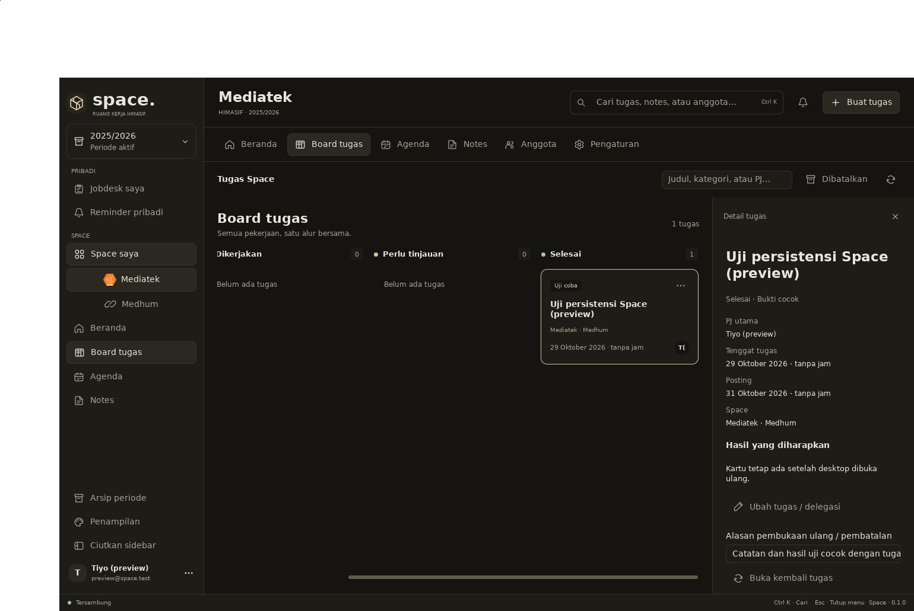

# Integrasi UI native dan inti jobdesk

Branch: `feat/native-ui`, basis backend PR #2 (`d92a372`). Dikerjakan 28 Oktober 2026. Acuan: PRD TSK-01–09, SPC-01, batas akun/role/45 dan kontrak [backend 1B–1C](backend-api-contract.md) serta [API tugas](tasks-api-contract.md).

## Perilaku

UI MyGo memuat Space dan kapabilitas dari server. ID Space/periode menentukan konteks, bukan nama divisi. Sidebar tidak menganggap direktori divisi sebagai keanggotaan. Pergantian akun/periode/Space membuang hasil permintaan lama; salinan bearer diambil sebelum pekerjaan asynchronous agar operasi yang antre tidak berpindah akun.

Undangan dapat dibuka lewat tautan atau ditempel di desktop. Akun baru memerlukan bukti email terpisah; akun lama masuk memakai email undangan dan menerima keanggotaan tanpa membuat akun ganda. Pemulihan memberikan jawaban seragam, reset menghapus sesi lokal, dan pengaturan akun menghubungkan perubahan password serta serah terima admin. Token undangan/pemulihan hanya berada di memori; browser membersihkan parameter rahasia dari fragment tautan.

Pengaturan anggota menggunakan API undangan/kirim ulang/cabut, pendamping, kelompok Tekno/Desain/Video, role operasional dan pengangkatan/pencopotan 45. Form mengikuti izin per divisi, termasuk di Medhum. Role 45 tidak dapat mengatur anggota/role/akses; kewenangan operasionalnya dapat dipersempit dan berlaku sampai dicopot. Periode tertutup hanya baca.

Satu objek tugas tersimpan di PostgreSQL, diproyeksikan ke jobdesk PJ/pelaksana tambahan dan Space yang terkait. Divisi pemilik selalu tertaut; berbagi ke Medhum bersifat eksplisit untuk tugas internal. Header menyediakan pembuatan tugas, pemilihan PJ aktif, hasil yang diminta, kategori, tenggat dan jadwal posting. Tenggat tanpa jam tetap berupa tanggal; jam eksplisit dikonversi menurut zona periode.

Board mempertahankan ID kartu dan menyimpan perpindahan/reorder melalui server. Panel kanan menyediakan perubahan delegasi/metadata, progres, penyerahan tautan/catatan hasil, pencocokan bukti beserta alasan, komentar, penawaran/keputusan bantuan dan riwayat. Bukti asli beserta waktu penyerahannya tidak dihapus oleh koreksi keputusan. Tugas dibatalkan dapat ditampilkan lagi untuk dibuka kembali oleh pengelola dengan alasan. Kalender menampilkan tenggat dan posting nyata, berlabel terpisah; pencarian header mencakup tugas pada snapshot aktif. Dropdown notifikasi memuat pembaruan tugas dari server dan membuka tugas yang masih dapat diakses.

Perubahan tidak dipresentasikan sebagai berhasil sebelum server mengonfirmasi. Konflik versi tidak menimpa data diam-diam; form menyimpan isian untuk diperiksa dan dapat dibuang secara eksplisit untuk memakai data terbaru. Gangguan koneksi mempertahankan snapshot terakhir dengan indikator, tanpa menjanjikan antrean offline.

## Migrasi

`0003_tasks.sql` menambahkan tugas, kaitan Space, urutan board, komentar, pengajuan/pelaksana tambahan, bukti, riwayat dan notifikasi. Migrasi tidak memodifikasi spreadsheet/Trello/WhatsApp/Reo. Mutasi mengunci periode sebelum tugas dan memeriksa ulang akun/akses; riwayat dan notifikasi relevan berada dalam transaksi yang sama. Lihat kontrak API untuk endpoint dan semantik versi.

## Koordinasi sesi reminder

`internal/store/migrations/0004_personal_reminders.sql` dicadangkan untuk Kiro pada branch `feat/personal-reminders`. Branch UI/tugas ini hanya menambahkan `0003_tasks.sql`; sesi Kiro tidak mengubah UI, backend tugas, atau migrasi 0003. Runner mencatat migrasi menurut nama file, sehingga urutan merge kedua branch tidak mensyaratkan penggantian nomor migrasi. Integrasi UI reminder dilakukan setelah kontrak backend sesi tersebut siap.

## Batas tahap ini

Irisan ini menyelesaikan integrasi akun/Space dan **inti** Sesi 2A pada PR #4. UI reminder kemudian tersambung melalui PR #5; lihat [handoff reminder](personal-reminders-ui.md). Rich notes/template tersimpan, rapat, scheduler H-2/H-1/H-0, ping, integrasi Sheets/Trello/WA, aturan deadline Medhum otomatis, temuan SOP, tray/toast/suara Windows, Ace, cache/antrean offline dan Flutter tetap tahap berikutnya. Notifikasi saat ini adalah pembaruan in-app yang dimuat saat membuka dropdown atau memperbarui; belum push terjadwal.

API pengelolaan periode/kadiv/checklist serah terima/izin arsip berasal dari backend PR #2. Form yang belum tersambung pada PR #4 kini dilengkapi dalam [integrasi administrasi](admin-ui.md). Metadata periode dan Space arsip yang diizinkan dapat dibaca. Produksi tidak diubah; runtime Xpra menggunakan database preview terpisah.

## Verifikasi

Pemeriksaan berikut lulus dengan Go 1.27.3, build serial `GOMAXPROCS=2 GOFLAGS=-p=1` dan temporary directory/cache di HDD:

- `go test -count=1 -json ./...` dengan PostgreSQL 17.11 nyata melalui database uji acak yang dibuat/dihapus oleh fixture. Seluruh tes backend berjalan: 36 tes server utama +14 subtes lulus, tanpa skip database. Dua tes screenshot opsional pada run umum dijalankan terpisah dengan variabel capture.
- Setelah perbaikan tata letak terakhir: `go test -count=1 ./internal/appui ./internal/client ./internal/workspaceui`, dengan kedua opsi capture aktif, lulus. Termasuk stale response/sesi, pemisahan divisi/45/arsip, tidak ada sukses palsu saat konflik, ID inspector tetap, endpoint belum tersedia tanpa siklus refresh, navigasi yang melepaskan filter lokal agar target terlihat, serta aksi Simpan terjangkau pada 1440×900 dan 880×640.
- `go vet ./...`, vet Windows `amd64`, dan vet WASM lulus. Vet UI pada ketiga platform diulang setelah perbaikan layout terakhir.
- Build API dan aplikasi Linux lulus. `go tool mygo build -platform web ./app` dan `-platform windows/amd64` lulus setelah perubahan terakhir: WASM sekitar 18,8 MB dan `Space.exe` sekitar 11,9 MB. Installer Windows tidak dibuat karena NSIS belum tersedia; pengujian runtime pada Windows nyata belum dilakukan.
- Gofmt dan `git diff --check` bersih. Renderer native ditinjau untuk mode terang/gelap, ukuran minimum, sidebar, board/inspector dan dropdown.

Uji manual pada **aplikasi Linux native melalui Xpra**, memakai backend/database preview terpisah:

1. Login nyata, pilih Mediatek, buat tugas lewat form, pilih PJ aktif, isi tenggat `2026-10-29` dan posting `2026-10-31`, lalu bagikan ke Medhum.
2. API mengonfirmasi satu ID yang sama pada jobdesk pribadi, Mediatek dan Medhum; kedua tanggal tetap date-only tanpa jam buatan.
3. Drag kartu ke Dikerjakan: server menyimpan progres dan versi 2, dengan riwayat `task.move`.
4. Restart API dan aplikasi, login kembali: ID, progres, kedua tanggal serta proyeksi masih sama.
5. Kirim catatan hasil lewat inspector: versi 3, `submitted/pending`. Tulis alasan lalu pilih Bukti sesuai: versi 4, `done/verified`. Waktu penyerahan asli tetap sama setelah tinjauan; riwayat menyimpan penyerahan dan keputusan.

Uji langsung menangkap tombol Simpan yang terpotong: `Fill()` pada area yang memiliki header mengambil tinggi penuh induknya, sehingga panel melampaui ruang tersedia. Area isi kini memakai `Grow(1).MinHeight(0)` untuk sisa ruang. Tes regresi menangkap kegagalan sebelum perbaikan dan lulus sesudahnya pada ukuran normal/minimum. Tidak ada instrumentasi debug yang ditambahkan ke kode produksi.

Review gabungan sebelum merge, perbaikan Kiro, dan tes kedua urutan migrasi: [review PR #3/#4](pr3-pr4-review.md).
